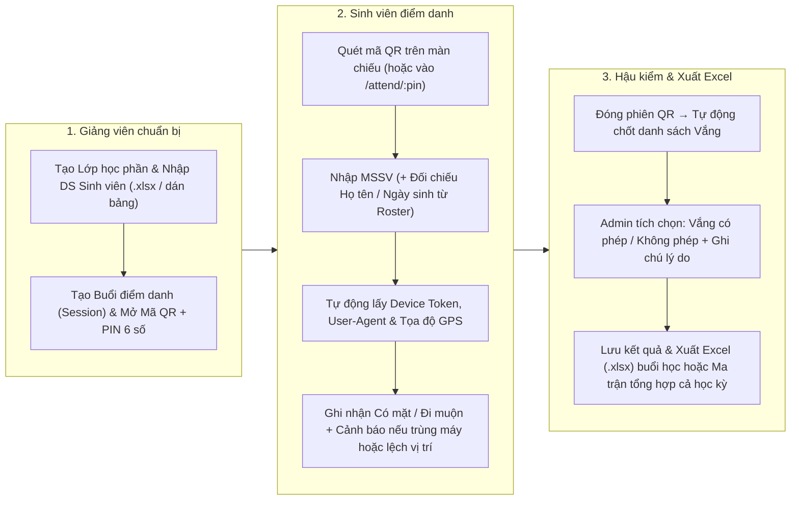

# KẾ HOẠCH THIẾT KẾ & TRIỂN KHAI TÍNH NĂNG ĐIỂM DANH LỚP HỌC (QR + DEVICE & GPS + EXCEL)
## Tích hợp vào VNEconomics Testing Platform

> **Phạm vi tài liệu:** Bản đặc tả kiến trúc, cơ sở dữ liệu, API PHP, cơ chế chống điểm danh hộ (Device Fingerprinting & GPS Geofencing / Median Clustering), quản lý vắng có phép / không phép và xuất báo cáo Excel chuyên cần trên nền tảng hiện có (`React 18 + TypeScript + Vite + Tailwind CSS` & `PHP + SQLite WAL / MySQL 8+` trên Plesk shared hosting).
> **Trạng thái:** Kế hoạch thiết kế chi tiết — Sẵn sàng rà soát trước khi triển khai code.

---

## 1. MỤC TIÊU & LUỒNG NGHIỆP VỤ TỔNG QUAN

Tính năng **Điểm danh Lớp học (Smart QR Attendance)** giúp giảng viên quản lý sĩ số độc lập với kỳ thi, tận dụng tối đa hạ tầng nhận diện thiết bị, định vị GPS và trình xử lý Excel (`xlsx`) sẵn có của hệ thống.

### Các điểm nổi bật trong thiết kế
1. **Quản lý theo Lớp học phần (`AttendanceClass`) & Buổi điểm danh (`AttendanceSession`):**
   - Giảng viên chỉ cần **upload danh sách sinh viên (Roster) 1 lần** cho Lớp học phần (tái sử dụng định dạng chuẩn của `studentRosterXlsx.ts`: *STT | Mã sinh viên | Họ đệm | Tên | Giới tính | Ngày sinh* hoặc thêm cột *Lớp sinh hoạt*).
   - Mỗi buổi học trên lớp (Buổi 1, Buổi 2, ...), giảng viên chỉ cần bấm **"+ Tạo buổi điểm danh mới"** từ lớp đó mà không phải nhập lại danh sách sinh viên.
2. **Chiếu QR Code & Đếm ngược trực tiếp trên màn hình lớn (Projector Mode):**
   - Màn hình chiếu hiển thị mã QR cỡ lớn, đường link rút gọn `/attend?pin=XXXXXX`, bộ đếm số lượng sinh viên đã điểm danh theo thời gian thực (`38/45 sinh viên có mặt`) và danh sách tên sinh viên vừa quét nổi lên trực tiếp.
   - Hỗ trợ tùy chọn **QR Động (Rotating QR Token mỗi 20–30 giây)** hoặc **Khóa tự động sau X phút** để ngăn sinh viên trong lớp chụp ảnh mã QR gửi qua Zalo/Messenger cho bạn ở nhà quét.
3. **Kiểm tra Thiết bị (Anti-Proxy Device Lock) & Kiểm tra Vị trí (GPS Verification):**
   - **Chống 1 điện thoại điểm danh giùm nhiều người:** Mỗi thiết bị (`device_token` + `browser_id` + IP/UA) chỉ được điểm danh cho **1 MSSV duy nhất** trong cùng một buổi học. Nếu dùng cùng điện thoại quét cho MSSV thứ 2, hệ thống sẽ **Chặn (Block)** hoặc gắn cờ đỏ **`DUPLICATE_DEVICE`** (tùy cấu hình giảng viên).
   - **Định vị GPS thông minh:** Ghi nhận `location_lat`, `location_lng`, `location_accuracy`. So sánh khoảng cách Haversine với **Tọa độ tâm của lớp học** (tự động tính theo **Trung vị — Median Coordinates** của cả lớp giống `LiveProctorTable.tsx`, hoặc theo **vị trí GPS của máy giảng viên** khi bấm mở phòng). Tự động gắn cờ **`FAR_LOCATION`** nếu sinh viên cách lớp lớn hơn bán kính cho phép (mặc định `150m – 200m`).
4. **Hậu kiểm Vắng có phép / Không phép & Xuất báo cáo Excel (`.xlsx`):**
   - Ngay trên bảng quản trị của buổi điểm danh, hệ thống hiển thị **100% danh sách sinh viên của lớp**, tự động phân loại những sinh viên chưa quét QR vào trạng thái **Vắng không phép (`ABSENT_UNEXCUSED`)**.
   - Giảng viên có thể chuyển nhanh trạng thái từng sinh viên giữa:
     - `PRESENT` (**Có mặt**)
     - `LATE` (**Đi muộn**)
     - `ABSENT_EXCUSED` (**Vắng có phép** — kèm ô nhập ghi chú: *"Ốm có giấy viện"*, *"Công tác Đoàn"*, ...)
     - `ABSENT_UNEXCUSED` (**Vắng không phép**)
   - Bấm **"Lưu bảng điểm danh"** và **"Xuất Excel (.xlsx)"**: Hỗ trợ xuất **Báo cáo chi tiết 1 buổi** (kèm thông tin thiết bị, khoảng cách GPS, ghi chú phép) và **Bảng tổng hợp chuyên cần toàn khóa (Multi-Session Matrix)** để tính điểm chuyên cần cuối kỳ.

---

## 2. THIẾT KẾ CƠ SỞ DỮ LIỆU (`api/schema.php`)

Bổ sung **3 bảng mới** vào hàm `ensureExamSchema()` trong [schema.php](file:///c:/Projects/Testing%20Platform/api/schema.php), tương thích song song cả **MySQL 8+ (InnoDB utf8mb4)** và **SQLite (WAL)**, kèm cơ chế fallback `localStorage` cho chế độ Demo Offline:

### 2.1. Bảng `attendance_classes` (Lớp danh sách sinh viên)
Lưu thông tin lớp học phần và danh sách sinh viên gốc (`roster_entries_json`) để dùng xuyên suốt nhiều buổi học.

| Cột | Kiểu (MySQL / SQLite) | Mô tả |
| :--- | :--- | :--- |
| `id` | `VARCHAR(64) PK` | ID lớp điểm danh (`acls_...`) |
| `owner_id` | `VARCHAR(64) INDEX` | ID giảng viên sở hữu (`SYSTEM_DEMO` hoặc ID giảng viên) |
| `course_id` | `VARCHAR(64) NULL` | Liên kết tới Học phần (`courses.id`) nếu có |
| `class_code` | `VARCHAR(64)` | Mã lớp học phần (VD: `ECO101_N02`) |
| `title` | `VARCHAR(255)` | Tên lớp (VD: `Kinh tế Vi mô 1 - Nhóm 02 - Thứ 2 Ca 1`) |
| `semester` | `VARCHAR(64)` | Học kỳ (VD: `HK1 2026-2027`) |
| `roster_entries_json` | `LONGTEXT` | Mảng JSON `StudentRosterEntry[]` (`studentCode`, `lastName`, `firstName`, `gender`, `dob`, `className`) |
| `created_at` | `VARCHAR(40)` | Thời điểm tạo (ISO-8601) |

### 2.2. Bảng `attendance_sessions` (Buổi điểm danh)
Mỗi lớp có thể tạo nhiều buổi điểm danh (Buổi 1, Buổi 2...).

| Cột | Kiểu (MySQL / SQLite) | Mô tả |
| :--- | :--- | :--- |
| `id` | `VARCHAR(64) PK` | ID buổi điểm danh (`ases_...`) |
| `class_id` | `VARCHAR(64) INDEX` | Khóa ngoại tới `attendance_classes.id` |
| `owner_id` | `VARCHAR(64)` | ID giảng viên |
| `title` | `VARCHAR(255)` | Tên buổi (VD: `Buổi 1 - ngày 23/11/2026`) |
| `session_date` | `VARCHAR(20)` | Ngày học (`YYYY-MM-DD`) |
| `checkin_pin` | `VARCHAR(16) INDEX` | Mã PIN 6 chữ số để vào trang điểm danh |
| `session_passcode` | `VARCHAR(32) NULL` | Mật khẩu buổi điểm danh (tự sinh 4 số hoặc GV tự đặt; rỗng = không yêu cầu pass) |
| `qr_secret` | `VARCHAR(64)` | Khóa bí mật sinh mã token QR động (nếu bật chống chụp màn hình QR) |
| `rotate_qr_seconds` | `INT DEFAULT 0` | `0`: QR tĩnh; `20` hoặc `30`: Đổi mã token QR mỗi 20–30s trên màn chiếu |
| `status` | `VARCHAR(32)` | `OPEN` (Đang mở quét), `CLOSED` (Đã đóng quét / Hậu kiểm) |
| `require_roster_match` | `TINYINT(1) DEFAULT 1` | `1`: Chỉ SV có trong danh sách lớp mới được điểm danh; `0`: Cho phép SV ngoài danh sách quét bổ sung |
| `require_gps` | `TINYINT(1) DEFAULT 1` | `1`: Bắt buộc bật Vị trí (GPS) trên điện thoại mới cho phép gửi điểm danh |
| `block_duplicate_device` | `TINYINT(1) DEFAULT 1` | `1`: Chặn cứng nếu 1 điện thoại điểm danh cho 2 MSSV; `0`: Cho qua nhưng gắn cờ cảnh báo đỏ |
| `instructor_lat` | `DOUBLE NULL` | Vĩ độ tâm phòng học (do GV bấm "Lấy vị trí phòng học" hoặc để `NULL` dùng trung vị cả lớp) |
| `instructor_lng` | `DOUBLE NULL` | Kinh độ tâm phòng học |
| `max_distance_meters` | `INT DEFAULT 200` | Bán kính hợp lệ tối đa (mặc định `200m`) |
| `late_after_minutes` | `INT DEFAULT 15` | Tự động đánh dấu `LATE` (Đi muộn) nếu quét sau X phút kể từ lúc mở (`0` = tắt) |
| `opened_at` | `VARCHAR(40)` | Thời điểm mở quét QR |
| `closed_at` | `VARCHAR(40) NULL` | Thời điểm khóa quét QR |
| `created_at` | `VARCHAR(40)` | Thời điểm khởi tạo |

### 2.3. Bảng `attendance_records` (Chi tiết trạng thái từng sinh viên trong buổi)
Lưu trữ cả lượt sinh viên tự quét QR và các chỉnh sửa hậu kiểm (`Vắng có phép` / `Vắng không phép`) của giảng viên.

| Cột | Kiểu (MySQL / SQLite) | Mô tả |
| :--- | :--- | :--- |
| `id` | `VARCHAR(64) PK` | ID bản ghi (`arec_...`) |
| `session_id` | `VARCHAR(64) INDEX` | Khóa ngoại tới `attendance_sessions.id` |
| `student_code` | `VARCHAR(64)` | Mã số sinh viên (chuẩn hóa in hoa) |
| `student_name` | `VARCHAR(255)` | Họ và tên đầy đủ |
| `last_name` | `VARCHAR(160)` | Họ đệm |
| `first_name` | `VARCHAR(80)` | Tên |
| `gender` | `VARCHAR(32)` | Giới tính |
| `dob` | `VARCHAR(32)` | Ngày sinh (`DD-MM-YYYY`) |
| `class_name` | `VARCHAR(128)` | Lớp sinh hoạt (nếu có) |
| `attendance_status` | `VARCHAR(32)` | `PRESENT` (Có mặt), `LATE` (Đi muộn), `ABSENT_EXCUSED` (Vắng có phép), `ABSENT_UNEXCUSED` (Vắng không phép) |
| `note` | `TEXT NULL` | Ghi chú của GV hoặc lý do xin phép (VD: *"Xin phép nghỉ ốm"*) |
| `check_in_source` | `VARCHAR(32)` | `QR_SCAN` (SV tự quét), `MANUAL_ADMIN` (GV tích tay trong Admin) |
| `device_token` | `VARCHAR(128) NULL` | Mã định danh thiết bị (`getOrCreateDeviceToken()`) |
| `browser_id` | `VARCHAR(128) NULL` | Mã cookie/storage trình duyệt (`getOrCreateBrowserId()`) |
| `device_label` | `VARCHAR(160) NULL` | Nhãn thiết bị & HĐH (VD: `Safari / iPhone`, `Chrome / Android`) |
| `ip_address` | `VARCHAR(64) NULL` | Địa chỉ IP lúc điểm danh |
| `location_lat` | `DOUBLE NULL` | Vĩ độ GPS của sinh viên |
| `location_lng` | `DOUBLE NULL` | Kinh độ GPS của sinh viên |
| `location_accuracy` | `DOUBLE NULL` | Sai số GPS (mét) |
| `distance_meters` | `INT NULL` | Khoảng cách tính tới tâm lớp học (mét) |
| `device_flag` | `VARCHAR(64) NULL` | `NULL` (Hợp lệ) hoặc `DUPLICATE_DEVICE:<MSSV_TRƯỚC>` |
| `location_flag` | `VARCHAR(64) NULL` | `NULL` (Hợp lệ), `FAR_LOCATION`, hoặc `NO_GPS` |
| `checked_in_at` | `VARCHAR(40) NULL` | Thời điểm SV quét QR thành công |
| `updated_at` | `VARCHAR(40)` | Thời điểm cập nhật gần nhất |

* **Ràng buộc duy nhất:** `UNIQUE (session_id, student_code)` — Mỗi sinh viên chỉ có 1 dòng trạng thái trong 1 buổi điểm danh.

---

## 3. CƠ CHẾ KIỂM TRA THIẾT BỊ & ĐỊNH VỊ VỊ TRÍ (SECURITY & ANTI-CHEAT)

### 3.1. Kiểm tra Thiết bị (Chống điểm danh hộ trên cùng 1 điện thoại)
1. **Định danh kép trên trình duyệt sinh viên:**
   - Kết hợp `getOrCreateDeviceToken()` (`localStorage`) và `getOrCreateBrowserId()` (`cookie + localStorage` 1 năm) sẵn có trong [apiClient.ts](file:///c:/Projects/Testing%20Platform/src/services/apiClient.ts#L24-L47), kèm chuỗi `getDeviceLabel()` (`Chrome / Android`, `Safari / iPhone`) và địa chỉ IP.
2. **Xử lý khi phát hiện trùng thiết bị trong cùng buổi (`session_id`):**
   - Khi sinh viên B gửi yêu cầu điểm danh, backend kiểm tra xem trong `attendance_records` của `session_id` đó đã có sinh viên A nào khác (`student_code != B`) sử dụng trùng `device_token` hoặc `browser_id` chưa:
     - **Nếu `block_duplicate_device = 1` (Mặc định):** Trả về lỗi `409 Conflict` ngay trên màn hình điện thoại: *"Thiết bị này đã được dùng để điểm danh cho sinh viên [Mã SV A - Tên A]. Mỗi điện thoại chỉ được điểm danh cho 1 sinh viên!"*
     - **Nếu `block_duplicate_device = 0` (Chế độ linh hoạt cho mượn máy):** Vẫn ghi nhận điểm danh nhưng tự động gắn cờ `device_flag = "DUPLICATE_DEVICE:2311556492"` để hiển thị cảnh báo màu đỏ trên bảng Admin cho giảng viên kiểm tra trực tiếp tại lớp.
3. **Khóa chiều ngược lại (Đã điểm danh trên máy này không cho đổi sang MSSV khác):**
   - Sau khi điểm danh thành công, màn hình điện thoại của sinh viên lưu phiếu xác nhận điểm danh của buổi đó (`vne_att_receipt_{sessionId}`) và hiển thị thẻ **"Điểm danh thành công"** kèm mã giờ, ẩn nút nhập MSSV khác.

### 3.2. Kiểm tra Vị trí (Location / GPS Verification)
1. **Thu thập tọa độ chuẩn xác:**
   - Tái sử dụng luồng `navigator.geolocation.getCurrentPosition({ enableHighAccuracy: true, timeout: 10000 })` và giao diện hướng dẫn mở quyền GPS trên iOS/Android, cảnh báo trình duyệt nhúng Zalo/Messenger (`isInAppWebView`) từ [HomePortalPage.tsx](file:///c:/Projects/Testing%20Platform/src/pages/HomePortalPage.tsx#L44-L110).
2. **Hai chế độ xác định "Tâm phòng học":**
   - **Cách 1 — Tâm theo Trung vị lớp học (Auto Median Centroid — Mặc định, không cần GV bật GPS máy tính):** Hệ thống tự động lấy trung vị (`medianLat`, `medianLng`) của toàn bộ sinh viên đã điểm danh có GPS trong buổi đó (giống thuật toán rất hiệu quả đang chạy ở [LiveProctorTable.tsx](file:///c:/Projects/Testing%20Platform/src/components/admin/LiveProctorTable.tsx#L138-L167)). Sinh viên nào ngồi ở quán cà phê hay ở nhà quét mã từ xa sẽ có khoảng cách `> 200m` so với đám đông trong lớp và bị gắn cờ **`FAR_LOCATION` (Cách lớp X km/m)**.
   - **Cách 2 — Tâm cố định theo GPS của Giảng viên (Optional Pin Location):** Khi tạo/mở buổi điểm danh, giảng viên có thể bấm nút **"Lấy GPS phòng học hiện tại"** để khóa cứng tọa độ phòng học (`instructor_lat`, `instructor_lng`) và đặt bán kính cho phép (VD: `150m`).

---

## 4. THIẾT KẾ API BACKEND (`api/attendance.php`)

Tạo file endpoint mới `api/attendance.php` sử dụng chung cơ chế xác thực Bearer Token (`requireAdminAuth()` / `resolveInstructorContext()`) từ `api/admin_auth.php`.

### 4.1. Nhóm API dành cho Giảng viên (Admin Auth Required)
* `GET /api/attendance.php?action=list_classes`: Lấy danh sách Lớp điểm danh của giảng viên kèm số lượng sinh viên và tổng số buổi đã điểm danh.
* `POST /api/attendance.php?action=save_class`: Tạo mới hoặc cập nhật Lớp điểm danh + danh sách sinh viên (`rosterEntries`).
* `POST /api/attendance.php?action=delete_class`: Xóa lớp điểm danh và các buổi thuộc lớp.
* `GET /api/attendance.php?action=list_sessions&classId=...`: Lấy danh sách các buổi điểm danh của lớp kèm thống kê nhanh (`presentCount`, `lateCount`, `excusedCount`, `unexcusedCount`, `alertCount`).
* `POST /api/attendance.php?action=create_session`: Tạo buổi điểm danh mới (tự động sinh `checkin_pin` 6 số, `qr_secret`, và **khởi tạo sẵn các dòng `attendance_records`** cho toàn bộ sinh viên trong `roster_entries_json` với trạng thái mặc định `ABSENT_UNEXCUSED` để giảng viên luôn thấy đủ danh sách lớp).
* `GET /api/attendance.php?action=session_detail&sessionId=...`: Lấy thông tin buổi điểm danh + toàn bộ danh sách `records` + mã `qrToken` hiện hành (nếu dùng QR động).
* `POST /api/attendance.php?action=toggle_session_status`: Mở lại (`OPEN`), Đóng khóa quét (`CLOSED`), hoặc làm mới mã PIN / QR.
* `POST /api/attendance.php?action=save_records_bulk`: Giảng viên tích chọn hàng loạt hoặc từng sinh viên (`PRESENT`, `LATE`, `ABSENT_EXCUSED`, `ABSENT_UNEXCUSED`) + sửa cột `note` (lý do vắng/phép) rồi bấm **"Lưu bảng điểm danh"**.
* `GET /api/attendance.php?action=class_summary_matrix&classId=...`: Trả về dữ liệu tổng hợp toàn bộ các buổi điểm danh của 1 lớp để xuất file Excel tổng kết chuyên cần cả học kỳ.

### 4.2. Nhóm API Công khai dành cho Sinh viên (Public Endpoints)
* `GET /api/attendance.php?action=lookup_pin&pin=XXXXXX`: Kiểm tra mã PIN buổi điểm danh, trả về thông tin tên lớp, tên buổi, trạng thái `OPEN/CLOSED`, yêu cầu mật khẩu (`requirePasscode: boolean` — **không trả về mật khẩu thật**), yêu cầu GPS (`requireGps`), và yêu cầu xác thực Roster (`requireRosterMatch`).
* `POST /api/attendance.php?action=checkin`:
  - **Input:** `{ pin, passcode?, qrToken?, studentCode, lastName?, firstName?, dob?, deviceToken, browserId, deviceLabel, hardwareFingerprint?, locationLat, locationLng, locationAccuracy }`.
  - **Xử lý:**
    1. Kiểm tra buổi điểm danh đang `OPEN`, đối chiếu `passcode` (nếu buổi học có đặt `session_passcode`) và kiểm tra `qrToken` hợp lệ (nếu bật QR động).
    2. Nếu `require_roster_match = 1`: Đối chiếu `studentCode` với danh sách lớp (tự động điền hoặc đối chiếu Họ tên / Ngày sinh). Nếu không có trong danh sách lớp → báo lỗi rõ ràng.
    3. Kiểm tra trùng thiết bị (`device_token` / `browser_id`) với sinh viên khác trong cùng buổi.
    4. Kiểm tra GPS và tính khoảng cách Haversine (`distance_meters`), gắn cờ `location_flag` nếu vượt `max_distance_meters`.
    5. Tính trạng thái `PRESENT` hoặc `LATE` (nếu thời gian hiện tại vượt quá `opened_at + late_after_minutes`).
    6. Cập nhật dòng `attendance_records` của sinh viên và trả về phiếu xác nhận điểm danh thành công.

---

## 5. THIẾT KẾ GIAO DIỆN NGƯỜI DÙNG (FRONTEND UI/UX)

### 5.1. Trang Sinh viên Quét QR Điểm danh (`src/pages/AttendanceCheckInPage.tsx`)
* **Định tuyến (Routes trong `src/App.tsx`):**
  - `/attend` và `/attend/:pin` (Mã QR trên màn chiếu sẽ trỏ thẳng vào `https://<domain>/attend/123456?t=<qrToken>`).
  - Thêm nút truy cập nhanh **"Điểm danh QR"** trên thanh điều hướng của trang chủ [HomePortalPage.tsx](file:///c:/Projects/Testing%20Platform/src/pages/HomePortalPage.tsx) để sinh viên cũng có thể tự nhập PIN 6 số nếu camera điện thoại bị hỏng.
* **Trải nghiệm trên điện thoại sinh viên (3 bước gọn nhẹ dưới 10 giây):**
  1. **Tự động nhận lớp từ QR:** Hiển thị rõ Tên học phần, Tên lớp, Tên buổi điểm danh (VD: *Kinh tế Vi mô 1 — Buổi 3*).
  2. **Nhập MSSV & Mật khẩu buổi điểm danh:**
     - Sinh viên nhập **Mã số sinh viên** (và Ngày sinh `DD-MM-YYYY` hoặc Họ tên để xác nhận đúng người, tránh gõ nhầm MSSV của bạn).
     - Nhập **Mật khẩu điểm danh (Passcode)** do giảng viên đọc trên lớp hoặc hiển thị trên màn chiếu (nếu buổi đó bật yêu cầu Passcode).
     - Cảnh báo ngay nếu mở trong WebView Zalo/Messenger và hướng dẫn mở bằng Safari/Chrome để lấy GPS ổn định.
  3. **Bấm "Xác nhận Điểm danh (Kèm Vị trí GPS)":**
     - Xin quyền GPS → Gửi API → Hiện màn hình **Thẻ Xác Nhận Điểm Danh Thành Công** (màu xanh ngọc, có đồng hồ giây thực tế, tên sinh viên, MSSV, trạng thái *Có mặt / Đi muộn*, nhãn thiết bị và khoảng cách GPS) để sinh viên có thể giơ màn hình cho giảng viên xem nếu cần.

### 5.2. Khu vực Quản trị Giảng viên (`src/components/admin/AttendanceTabPanel.tsx`)
Bổ sung tab **`8. Điểm danh QR`** (`id: 'ATTENDANCE'`) vào `AdminDashboardPage.tsx` và cập nhật đồng bộ trong `src/data/adminGuideRegistry.ts` (để pass bài test đồng bộ `tests/guideSync.test.ts`).

Giao diện trong tab **Điểm danh QR** gồm 3 khu vực trực quan:

1. **Cột trái / Thanh chọn Lớp học phần & Nhập danh sách sinh viên:**
   - Nút **"+ Tạo Lớp điểm danh"** (chọn Học phần, đặt tên lớp).
   - Nút **"Tải Excel mẫu (.xlsx)"** và **"Upload Danh sách SV (.xlsx)"** (tái sử dụng trực tiếp `downloadStudentRosterTemplateXlsx` và `parseStudentRosterXlsx` trong [studentRosterXlsx.ts](file:///c:/Projects/Testing%20Platform/src/utils/studentRosterXlsx.ts), đồng thời hỗ trợ thêm/xóa từng sinh viên trực tiếp trên giao diện).
2. **Danh sách Buổi điểm danh & Màn hình Chiếu QR (Projector Modal):**
   - Nút **"+ Tạo Buổi điểm danh mới"** (mặc định điền sẵn *"Buổi X - Ngày DD/MM/YYYY"*, tùy chọn: **Mật khẩu điểm danh (Passcode)** tự sinh 4 số hoặc tự nhập, *Bắt buộc GPS*, *Bán kính 200m*, *Chặn 1 máy điểm danh hộ*, *Tính đi muộn sau 15 phút*, *Làm mới mã QR mỗi 30 giây*).
   - Nút **"Chiếu Mã QR Điểm danh (Phóng to)"**: Mở màn hình Fullscreen nền tối sắc nét cho máy chiếu, hiển thị:
     - Mã QR lớn + Mã PIN 6 số + nút **Ẩn/Hiện Passcode** trên màn chiếu (cho phép giảng viên ẩn đi để đọc miệng trực tiếp trên lớp, chống tuyệt đối việc chụp màn hình gửi cho bạn ở nhà).
     - Thanh tiến độ sĩ số realtime: **`39 / 45 Sinh viên đã có mặt (86.7%)`** (tự động cập nhật mỗi 2.5 giây).
     - Danh sách thẻ sinh viên vừa quét mã chạy trực tiếp trên màn hình để cả lớp cùng thấy tên mình đã lên bảng.
3. **Bảng Hậu kiểm Điểm danh (Check Vắng có phép / Không phép & Kiểm tra Gian lận):**
   - **Thẻ thống kê nhanh (Filter Chips):**
     - `Tất cả (45)` | `Có mặt (38)` | `Đi muộn (2)` | `Vắng không phép (4)` | `Vắng có phép (1)` | `⚠️ Cảnh báo Thiết bị / Vị trí (2)`
   - **Bảng danh sách sinh viên đầy đủ:**
     | STT | MSSV | Họ và tên | Thời gian quét | Thiết bị & Vị trí GPS | Trạng thái điểm danh (Chọn nhanh 1 chạm) | Ghi chú / Lý do phép |
     | :--- | :--- | :--- | :--- | :--- | :--- | :--- |
     | 1 | `2026000001` | Nguyễn Văn An | `07:34:12` | `Safari / iPhone` • 📍 Cách tâm 18m | **[● Có mặt]** [Đi muộn] [Vắng CP] [Vắng KP] | *(Trống)* |
     | 2 | `2026000002` | Trần Thị Bình | *(Chưa quét)* | — | [Có mặt] [Đi muộn] **[● Vắng có phép]** [Vắng KP] | `Nghỉ ốm (có giấy phép)` |
     | 3 | `2026000003` | Lê Hoàng Cường | *(Chưa quét)* | — | [Có mặt] [Đi muộn] [Vắng CP] **[● Vắng không phép]** | *(Trống)* |
     | 4 | `2026000004` | Phạm Minh Dung | `07:48:05` | ⚠️ `Trùng máy 2026000001` • 📍 Cách 1.4km | [Có mặt] **[● Đi muộn]** [Vắng CP] [Vắng KP] | `Cần kiểm tra tại lớp` |
   - **Thanh công cụ thao tác nhanh:**
     - Nút **"Đánh dấu tất cả SV chưa quét là Vắng không phép"**.
     - Nút **"Lưu thay đổi"** (ghi nhận toàn bộ trạng thái Có mặt / Đi muộn / Vắng có phép / Vắng không phép & ghi chú vào database).

---

## 6. THIẾT KẾ NHẬP & XUẤT FILE EXCEL (`.xlsx`) (`src/utils/attendanceXlsx.ts`)

Sử dụng thư viện `xlsx` sẵn có trong `package.json` để hỗ trợ **đọc trực tiếp file danh sách điểm danh xuất từ cổng đào tạo của Trường** và xuất file `.xlsx` chuẩn tiếng Việt:

### 6.1. Đọc thông minh File Danh sách Điểm danh Lớp học phần của Trường
Parser tự động quét 20 dòng đầu để trích xuất metadata và nhận diện dòng tiêu đề `STT | MSSV | Họ đệm | Tên | Lớp học | Có phép | Không phép | Số tiết | Ghi chú`:
* **Tự động điền thông tin lớp:** Trích xuất `Tên môn` (VD: `ECO101 - DEMO101 - Kinh tế Vi mô 1`), `Học kỳ` (`HK 1 NH 2026-2027`), `Số tín chỉ`, `Giảng viên`, `Ngày điểm danh`.
* **Chuẩn hóa MSSV số thực từ Excel:** Xử lý sạch các ô MSSV bị Excel lưu dạng số (`2026000001.0` → `"2026000001"`), giữ nguyên số `0` ở đầu nếu có.
* **Hỗ trợ lớp ghép:** Lưu đúng cột `Lớp học` từng sinh viên (VD: `DEMO101`, `DEMO102.GHEP`) để lọc/hiển thị trong Admin.
* **Bỏ qua phần chân trang (Footer):** Tự động bỏ qua các dòng `Nhận xét:`, ngày ký và chữ ký giảng viên ở cuối file, không báo lỗi nhầm.

### 6.2. Xuất file Excel (`.xlsx`)
1. **Chế độ 1 — Xuất Excel Buổi điểm danh hiện tại (`DiemDanh_<MaLop>_<TenBuoi>.xlsx`):**
   - **Sheet 1 (`BangDiemDanh` — Đúng mẫu chuẩn của Trường):**
     - Giữ nguyên phần đầu: `DANH SÁCH ĐIỂM DANH LỚP HỌC PHẦN`, `Học kỳ`, `Tên môn`, `Số tín chỉ`, `Giảng viên`, `Ngày điểm danh`.
     - Bảng dữ liệu chính: `STT` | `MSSV` | `Họ đệm` | `Tên` | `Lớp học` | `Có phép` *(đánh dấu `x` hoặc `1`)* | `Không phép` *(đánh dấu `x` hoặc `1`)* | `Số tiết` | `Ghi chú` *(tự động ghi `Đi muộn lúc HH:mm` hoặc lý do xin phép)*.
     - Giữ phần cuối: `Nhận xét:`, ngày tháng và chữ ký giảng viên.
   - **Sheet 2 (`ChiTietThietBi_GPS`):** Bảng đối soát kỹ thuật gồm `Thời gian quét`, `Trạng thái`, `Thiết bị`, `Khoảng cách GPS (m)`, `Cảnh báo (Trùng máy / Lệch vị trí)`.
2. **Chế độ 2 — Xuất Excel Tổng hợp Chuyên cần cả Lớp (`TongHopChuyenCan_<MaLop>.xlsx`):**
   - **Sheet 1 (`MaTranChuyenCan`):**
     - Mỗi sinh viên là 1 dòng (kèm `MSSV`, `Họ đệm`, `Tên`, `Lớp học`), các cột tiếp theo là từng buổi học (`Buổi 1 (25/11)`, `Buổi 2 (...)`, ...) hiển thị ký hiệu chuẩn:
       - `✓` (Có mặt)
       - `M` (Đi muộn)
       - `P` (Vắng có phép)
       - `K` (Vắng không phép)
     - Các cột tổng kết cuối bảng: **Tổng số buổi**, **Có mặt**, **Đi muộn**, **Vắng có phép**, **Vắng không phép**, **Tỷ lệ chuyên cần (%)** — giúp giảng viên tính điểm quá trình / điều kiện dự thi ngay lập tức.

---

## 7. LỘ TRÌNH TRIỂN KHAI (IMPLEMENTATION STEPS)

Sau khi bạn duyệt bản kế hoạch này, chúng ta sẽ triển khai tuần tự theo 6 bước sạch sẽ, đảm bảo không ảnh hưởng tới các tính năng Thi và Live Game hiện có:

1. **Bước 1 — Database & Types (`api/schema.php`, `src/types/attendance.ts`):**
   - Khai báo 3 bảng `attendance_classes`, `attendance_sessions`, `attendance_records` trong `ensureExamSchema()` (MySQL + SQLite) và định nghĩa đầy đủ interface TypeScript.
2. **Bước 2 — Backend API & Local Fallback (`api/attendance.php`, `src/services/attendanceApi.ts`):**
   - Xây dựng API quản lý lớp, tạo buổi điểm danh, xử lý quét QR kèm kiểm tra thiết bị (`device_token`/`browser_id`) + khoảng cách GPS Haversine, lưu hậu kiểm vắng có phép / không phép và hỗ trợ chế độ Demo (`localStorage`) khi chạy local.
3. **Bước 3 — Tiện ích Xuất/Nhập Excel Điểm danh (`src/utils/attendanceXlsx.ts`):**
   - Kết nối parser danh sách sinh viên và viết hàm xuất file `.xlsx` (Báo cáo chi tiết từng buổi & Ma trận tổng hợp chuyên cần nhiều buổi).
4. **Bước 4 — Trang Sinh viên Quét QR Điểm danh (`src/pages/AttendanceCheckInPage.tsx`):**
   - Giao diện mobile-first tại `/attend` và `/attend/:pin`, tự động lấy GPS, kiểm tra thiết bị, đối chiếu MSSV trong Roster và hiển thị thẻ xác nhận điểm danh thành công.
5. **Bước 5 — Giao diện Quản trị Điểm danh & Màn chiếu QR trong Admin (`src/components/admin/AttendanceTabPanel.tsx`, `src/pages/AdminDashboardPage.tsx`):**
   - Tích hợp tab **Điểm danh QR**, màn hình chiếu QR toàn màn hình realtime, bảng hậu kiểm tích chọn *Có mặt / Đi muộn / Vắng có phép / Vắng không phép*, ghi chú lý do, cảnh báo trùng máy/lệch vị trí và nút Xuất Excel.
6. **Bước 6 — Đồng bộ Hướng dẫn & Kiểm thử (`src/data/adminGuideRegistry.ts`, `tests/`):**
   - Cập nhật hướng dẫn sử dụng tab mới trong `ADMIN_TAB_REGISTRY`, viết unit test kiểm tra logic tính khoảng cách GPS / phát hiện trùng thiết bị / xuất dữ liệu và chạy `npm run typecheck`, `npm test`, `npm run build`.

---

## 8. RÀ SOÁT KỸ THUẬT & CÁC RỦI RO TIỀM ẨN ĐÃ KHẮC PHỤC TRONG THIẾT KẾ

1. **QR Động bị hết hạn giữa chừng khi SV đang gõ MSSV / chờ GPS:**
   - *Rủi ro:* Nếu QR đổi mỗi 20–30s và server chỉ nhận đúng 1 token hiện tại, SV quét ở cuối chu kỳ sẽ bị từ chối oan.
   - *Giải pháp:* Dùng cơ chế **Sliding Window (chấp nhận slot hiện tại `T` và slot liền trước `T-1`)** hoặc cấp `scanTicket` ngắn hạn (90s) ngay khi mở trang từ QR hợp lệ.
2. **Phụ thuộc API tạo QR bên ngoài (`api.qrserver.com`):**
   - *Rủi ro:* Khi bật QR động đổi liên tục mỗi 20–30s, gọi ảnh từ server ngoài dễ bị chậm, cache hoặc nghẽn mạng phòng học.
   - *Giải pháp:* Dùng thư viện tạo QR **client-side offline (`qrcode`)** render trực tiếp `<svg>`/`<canvas>` trên trình duyệt (0ms độ trễ, hoạt động cả khi mất mạng ngoài).
3. **File Excel danh sách lớp thiếu cột Giới tính / Ngày sinh:**
   - *Rủi ro:* `parseStudentRosterXlsx()` hiện tại trong `studentRosterXlsx.ts` bắt buộc đủ 5 trường (`studentCode`, `lastName`, `firstName`, `gender`, `dob`) — nếu file lớp chỉ có `MSSV` và `Họ tên` sẽ báo lỗi toàn bộ.
   - *Giải pháp:* Bổ sung chế độ parse linh hoạt cho điểm danh (hỗ trợ cả cột `Họ và tên` gộp, chỉ bắt buộc `Mã SV` + `Họ tên`; `Giới tính`, `Ngày sinh`, `Lớp` là tùy chọn).
4. **Lỗ hổng Tab Ẩn danh (Incognito) hoặc dùng 2 trình duyệt trên 1 điện thoại:**
   - *Rủi ro:* Mở tab ẩn danh tạo mới `localStorage` & `cookie`, làm mới `device_token` và `browser_id`.
   - *Giải pháp:* Bổ sung `hardware_fingerprint` nhẹ (tổ hợp độ phân giải màn hình, `devicePixelRatio`, `hardwareConcurrency`, `platform`, `timezone`) kết hợp IP để gắn cờ cảnh báo `SUSPECTED_SAME_DEVICE` bên cạnh cơ chế khóa cứng `device_token`/`browser_id`.
5. **Sai số GPS trong phòng học kín (Indoor Drift) & Tâm Trung vị động:**
   - *Rủi ro:* SV đầu tiên quét chưa có `medianCoords` của lớp; hoặc GPS trong nhà bị nhảy sai số 150–250m gây cảnh báo oan `FAR_LOCATION`.
   - *Giải pháp:* Lưu tọa độ thô (`lat`, `lng`, `accuracy`) và **tính lại `distance_meters` động** khi có `>= 3` SV có GPS (nếu không khóa GPS GV); đồng thời trừ hao sai số `min(accuracy, 150)m` trước khi gắn cờ vượt bán kính. Lưu ý: Trình duyệt di động yêu cầu **HTTPS** để bật GPS.
6. **An toàn Schema Migration & Bảo mật dữ liệu lớp (PII):**
   - *Rủi ro:* Quên cập nhật khối fast-check ở đầu `ensureExamSchema()` trong `api/schema.php` sẽ khiến 3 bảng mới không được tạo trên DB đang chạy; hoặc trả nhầm toàn bộ danh sách lớp qua API public.
   - *Giải pháp:* Bổ sung query kiểm tra `attendance_classes`, `attendance_sessions`, `attendance_records` vào fast-check của `ensureExamSchema()`, và tuyệt đối chỉ đối chiếu MSSV ở backend (không trả danh sách lớp ra endpoint public).

