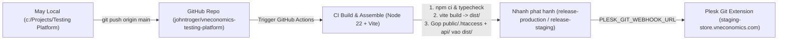
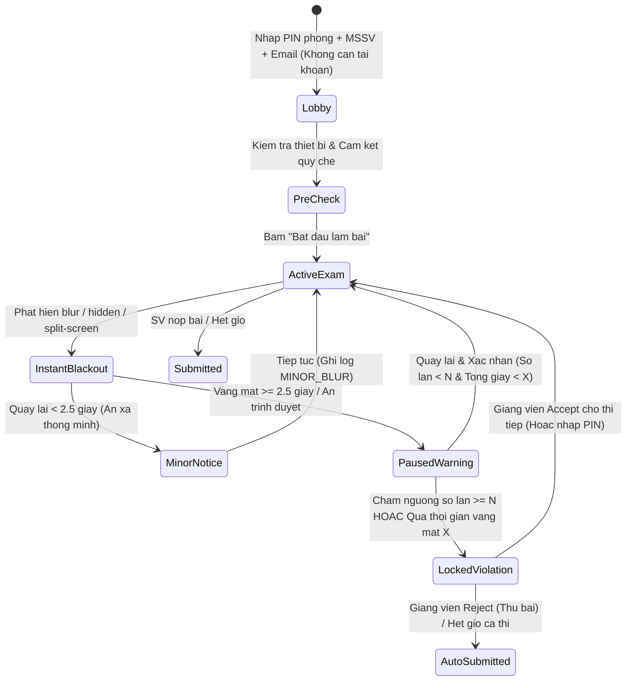
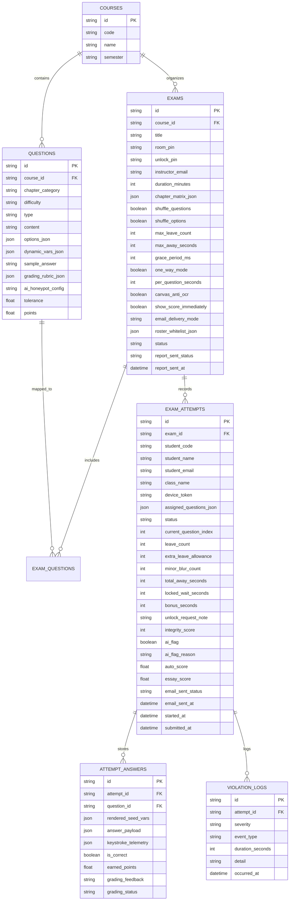

# KẾ HOẠCH KIẾN TRÚC & THIẾT KẾ HỆ THỐNG KHẢO THÍ TRỰC TUYẾN
## VNEconomics Testing Platform (`staging-store.vneconomics.com`)

> **Phạm vi tài liệu:** Bản đặc tả tổng thể về kiến trúc phần mềm, quy trình CI/CD tự động đồng bộ `GitHub → Plesk`, thiết kế UI/UX tối ưu điện thoại (Mobile-First) và ma trận phòng vệ 8 lớp chống gian lận / chống sử dụng AI khi làm bài kiểm tra các học phần môn học.
> **Trạng thái:** Chốt kế hoạch trước khi triển khai code (thay thế hoàn toàn giao diện hiện tại của `https://staging-store.vneconomics.com/`).

---

## 1. TỔNG QUAN DỰ ÁN & MỤC TIÊU

- **Tên hệ thống:** **VNEconomics Testing Platform** — Hệ thống Khảo thí & Kiểm tra Học phần Trực tuyến.
- **Tên miền triển khai:** `https://staging-store.vneconomics.com/` (thay thế hoàn toàn giao diện cũ).
- **Đối tượng sử dụng:**
  - **Sinh viên:** Làm bài kiểm tra trực tuyến các học phần môn học (Kinh tế Vi mô, Kinh tế Vĩ mô, Kinh tế Lượng, Tài chính - Tiền tệ...) chủ yếu bằng điện thoại di động (iOS / Android).
  - **Giảng viên / Quản trị viên:** Quản lý học phần, ngân hàng câu hỏi, cấu hình ca thi, giám sát phòng thi trực tiếp (Live Proctoring), mở khóa/thu bài từ xa, chấm tự luận ngắn và xuất bảng điểm kèm chỉ số tin cậy.
- **3 Mục tiêu cốt lõi:**
  1. **Tối ưu 100% trên điện thoại (Mobile-First UX):** Thao tác bằng một tay trên màn hình `100dvh`, vùng chạm đáp án lớn ở vùng ngón cái, tích hợp sẵn máy tính bỏ túi và bảng nháp ngay trong màn hình thi để tránh chạm nhầm hoặc bị khóa bài oan.
  2. **Chống gian lận & Chống sử dụng AI đa tầng (8 Lớp Bảo vệ):** Khi sinh viên rời màn hình thi để chụp ảnh gửi AI hoặc chuyển sang app AI (ChatGPT, Gemini, Google Lens), hệ thống ẩn đề tức thì (`< 16ms`) và tạm dừng làm bài; đồng thời bổ sung các cơ chế khảo thí chủ động (Biến số động, Bẫy AI Ngầm, Chống OCR, Khóa 1 thiết bị) để khắc chế cả trường hợp dùng **điện thoại thứ 2** chụp màn hình.
  3. **Tự động hóa CI/CD chuẩn `VneconomicsStore` (`Local → GitHub → Plesk`):** Đẩy code lên repository GitHub riêng, GitHub Actions tự kiểm tra kiểu tĩnh, build gói SPA + PHP API + `.htaccess`, đẩy sang nhánh phát hành để **Plesk Git Extension** tự động kéo về thư mục web của `staging-store.vneconomics.com`.

---

## 2. KIẾN TRÚC KỸ THUẬT & LUỒNG CI/CD TỰ ĐỘNG ĐỒNG BỘ PLESK

### 2.1. Ngăn xếp công nghệ (Tech Stack)

Dựa trên cấu hình thực tế của hạ tầng hosting Plesk Mắt Bão (`Apache/LiteSpeed + PHP 8.3.36 FastCGI`, không chạy Node.js runtime trên server), hệ thống dùng chung bộ công nghệ đã kiểm chứng từ dự án `VneconomicsStore`:

| Thành phần | Công nghệ lựa chọn | Lý do kỹ thuật |
| :--- | :--- | :--- |
| **Frontend (SPA)** | **Vite 6 + React 18 + TypeScript + Tailwind CSS 3.4 + React Router DOM v7 + Lucide Icons** | Biên dịch thành các tệp tĩnh (`dist/`) siêu nhẹ, phản hồi giao diện tức thì (`< 16ms` khi ẩn đề), tương thích tuyệt đối với Apache/LiteSpeed trên Plesk. |
| **Design System & Typography** | Đồng bộ từ `VneconomicsStore`:<br>- Font: `Plus Jakarta Sans` (Heading/Display), `Inter` (Body), `JetBrains Mono` (Đồng hồ, Mã PIN, số liệu)<br>- Màu chủ đạo: `brand-600: #2456b8` (VNEconomics Deep Blue), `support-600: #126a61` (Teal Support), `ink-900: #16243a` (Deep Navy Ink), nền `surface-100: #f8fafc` / `#ffffff` | Giữ nhất quán nhận diện thương hiệu VNEconomics; tương phản cao, rõ chữ trên màn hình điện thoại ngoài trời hoặc phòng học. |
| **Backend API (`api/`)** | **PHP 8.3 REST API (`api/*.php`) + PDO Prepared Statements** | Chạy trực tiếp trên PHP 8.3.36 FastCGI sẵn có của Plesk (RAM `3072M`, timeout `300s`), không cần server Node.js riêng. Bảo mật 100% chống SQL Injection. |
| **Cơ sở dữ liệu (Dual-Database & Persistent Storage)** | **SQLite Ngoài Webroot (`../.exam_data/vne_testing.sqlite`) + MySQL Plesk Ready (`vne35060_wp_udx1z`)** | - **An toàn tuyệt đối khi CI/CD Deploy:** Ưu tiên kết nối MySQL Plesk hoặc lưu file SQLite tại thư mục bền vững **nằm ngoài thư mục Git webroot** (`../.exam_data/`, chỉ fallback vào `api/data/` khi chạy local) để lệnh `git push -f` của GitHub Actions không bao giờ ghi đè hay làm mất dữ liệu bài thi.<br>- **Sẵn sàng MySQL:** Dùng bộ nạp `Multi-Level Config Loader` đọc `config.php` đặt tại thư mục cha ngoài `httpdocs` (`/var/www/vhosts/vneconomics.com/config.php`). |
| **Hệ thống Gửi Email Tự động (`api/mailer.php`)** | **Dual-Transport PHP 8.3 Mailer (Native Socket SMTP TLS/SSL + Plesk `mail()` Fallback)** | - Hỗ trợ gửi qua SMTP (Gmail / Google Workspace / Mail tên miền Plesk) kèm tệp đính kèm MIME multipart `.csv` (UTF-8 BOM), tự động fallback sang hàm `mail()` gốc của Plesk nếu chưa cấu hình SMTP.<br>- Ghi nhận trạng thái gửi (`SENT` / `FAILED`) trong DB để giảng viên theo dõi hoặc bấm gửi lại. |
| **Hệ thống Chấm Tự luận Ngắn Tự động (`api/essay_grader.php`)** | **Deterministic Smart Keyword & Concept-Chain Grader (PHP 8.3 Native + UTF-8 Vietnamese Normalizer)** | - Chấm tức thì (`< 1ms/bài`) ngay trên CPU Plesk dựa trên **Rubric từng ý (`grading_rubric_json`), từ đồng nghĩa, cặp biến–hướng (`tăng/giảm`, `phải/trái`) và chuỗi logic mũi tên (`->`)**, không phụ thuộc AI ngoài, không tốn phí API và không nghẽn mạng khi 100 sinh viên nộp bài đồng loạt.<br>- Hỗ trợ tự động nội suy biến số động `{a}, {b}` vào đáp án mẫu, chống đoán mò bao vây từ khóa và miễn nhiễm 100% với Prompt Injection. |
| **Chống mất bài (Offline Resilience)** | **`LocalStorage` + Heartbeat Auto-Sync (`5 giây/lần`)** | Mọi đáp án chạm chọn được lưu ngay vào máy sinh viên và đồng bộ ngầm về PHP API. Nếu rớt mạng 4G tạm thời, dữ liệu không bị mất và tự đồng bộ lại khi có sóng. |

### 2.2. Quy trình CI/CD Tự động (`Local → GitHub → GitHub Actions → Plesk`)

Dự án được quản lý trên một Repository GitHub độc lập mới: **`johntroger/vneconomics-testing-platform`** (tách biệt hoàn toàn khỏi mã nguồn `johntroger/vneconomics-store`).



**Các bước trong file `.github/workflows/deploy-plesk.yml`:**
1. **Checkout & Setup Node 22:** Kéo mã nguồn nhánh `main` và cache `npm`.
2. **Kiểm tra tĩnh & Build:** Chạy `npm ci`, `npm run typecheck` (`tsc --noEmit`) và `npm run build` (`vite build` xuất ra `dist/`).
3. **Đóng gói Payload cho Plesk (`dist/`):**
   - Copy `public/.htaccess` → `dist/.htaccess`: Điều hướng mọi route SPA (`/exam/...`, `/admin/...`) về `index.html`, ngoại trừ `/api/*` đi thẳng vào PHP handler; chặn truy cập trực tiếp các file `.env`, `.sql`, `.sqlite`, `.jsonl`, `config.php`.
   - Copy toàn bộ thư mục `api/*` → `dist/api/`.
   - Tạo `dist/build-info.txt` ghi thời gian build và `GITHUB_SHA`.
4. **Đồng bộ nhánh phát hành & Kích hoạt Webhook:**
   - Khởi tạo git trong `dist/` và `git push -f` lên nhánh phát hành dành cho Plesk Git Extension.
   - Gọi `curl -k -X POST "$PLESK_GIT_WEBHOOK_URL"` (nếu đã cấu hình Secret) để Plesk tự động pull mã mới nhất vào `/var/www/vhosts/vneconomics.com/staging-store.vneconomics.com/`.

---

## 3. KIẾN TRÚC PHÒNG VỆ CHỐNG GIAN LẬN & CHỐNG AI (8 LỚP BẢO VỆ)

Hệ thống không chỉ dừng ở việc cảnh báo chuyển tab đơn thuần mà thiết kế theo mô hình **phòng vệ đa tầng**, khắc chế từ việc thoát app sang ChatGPT/Gemini cho tới tấn công bằng thiết bị phụ (điện thoại thứ 2 chụp ảnh màn hình).

### 3.1. Sơ đồ Trạng thái Bài thi (Exam State Machine)



### 3.2. Chi tiết 8 Lớp Bảo vệ Chuyên sâu

| Lớp | Tên cơ chế | Cơ chế hoạt động kỹ thuật | Mục tiêu khắc chế |
| :---: | :--- | :--- | :--- |
| **1** | **Phản xạ Ẩn đề Tức thì (`< 16ms` Instant Blackout) & Tạm dừng** | Lắng nghe đồng thời `document.visibilitychange` (`hidden`), `window.blur` (`!document.hasFocus()`), `pagehide` và sự kiện thoát `Fullscreen`. Trong cùng frame `< 16ms`, phủ đen/làm mờ 100% nội dung đề thi và khóa mọi tương tác chọn đáp án. | Ngăn OS chụp được nội dung chữ trong ảnh thu nhỏ App Switcher (đa nhiệm) hoặc khi kéo thanh thông báo / chụp ảnh màn hình. |
| **2** | **Ân xá Thông minh `2.5s` & Quy tắc Khóa Chờ Giảng viên Duyệt (`Instructor Approval Gate`)** | - **Ân xá `< 2.5s`:** Nếu sinh viên bị mất focus dưới 2.5 giây (thông báo pin yếu 20%, popup hệ thống, lỡ chạm cạnh màn hình) → Hệ thống vẫn ẩn đề tức thì, nhưng khi quay lại chỉ nhắc nhở nhẹ và ghi log `MINOR_BLUR`, **không trừ lượt vi phạm chính thức**.<br>- **Vi phạm chính thức (`>= 2.5s` hoặc `hidden`):** Tính 1 lần vi phạm (`MAJOR_LEAVE`), bật bộ đếm `AwayTimer` trong khi **đồng hồ tổng của bài thi vẫn chạy ngầm**.<br>- **Chạm ngưỡng — Tạm khóa chờ Giảng viên quyết định (`LOCKED`):** Khi **Số lần rời màn hình `>= N` (mặc định 3 lần)** HOẶC **Thời gian vắng mặt vượt `X giây` (mặc định 20s/lần hoặc 45s tổng)**, hệ thống **KHÔNG tự động thu bài ngay** mà chuyển sang trạng thái **Tạm khóa (`LOCKED`)**. Màn hình điện thoại hiển thị trạng thái *"Đang chờ Giảng viên phê duyệt"*, cho phép sinh viên gửi kèm lý do ngắn (`unlock_request_note`) và tự đồng bộ trạng thái mỗi `3 giây` với `api/proctor.php`.<br>- **Quyền quyết định thuộc về Giảng viên:** Trên Dashboard Live, giảng viên xem nhật ký vi phạm và chọn **Accept ("Chấp nhận cho thi tiếp")** (cộng thêm hạn mức `extra_leave_allowance` để điện thoại tự mở khóa trong 3s mà vẫn giữ nguyên lịch sử vi phạm, hoặc nhập trực tiếp PIN 4 số tại bàn) hoặc **Reject ("Từ chối & Thu bài ngay")** để kết thúc và chấm phần đã làm. | Triệt tiêu gian lận thoát màn hình chờ AI trả lời; không khóa oan khi điện thoại báo pin yếu, đồng thời trao toàn quyền xử lý tình huống phát sinh cho Giảng viên. |
| **3** | **Phát hiện Chia đôi Màn hình (`Split-Screen`) & Phân biệt Bàn phím ảo** | Theo dõi `window.visualViewport.resize`. Kiểm tra xem `document.activeElement` có phải là `INPUT` hoặc `TEXTAREA` hay không:<br>- Nếu đang gõ ô điền số/tự luận → Xác định là bàn phím ảo bật lên → **Không báo lỗi**.<br>- Nếu kích thước khung nhìn bị co bất thường (chiều rộng giảm hoặc chiều cao giảm khi không nhập liệu) → Khóa màn hình báo lỗi **Chia đôi màn hình / Cửa sổ nổi**. | Chặn sinh viên Android/iPad vừa mở trình duyệt thi vừa mở cửa sổ nổi ChatGPT/Gemini bên cạnh. |
| **4** | **Ma trận Bốc Đề theo Chương (`Stratified Chapter Pool`), Trộn Đề Đa tầng & Biến số Động** | - **Bốc đề phân tầng theo Chương:** Với ngân hàng câu hỏi chia theo từng chương (`chapter_category`), Server dùng thuật toán `Seeded Fisher-Yates` theo `Seed(MSSV + ExamID)` để bốc ngẫu nhiên đúng tỷ lệ/số câu của từng chương theo ma trận đề (`chapter_matrix_json`), giúp hai sinh viên ngồi cạnh có thể nhận bộ câu hỏi khác nhau nhưng cùng cấu trúc kiến thức.<br>- **Trộn đề Đa tầng thông minh:** Đảo thứ tự câu hỏi (toàn đề hoặc giữ nguyên nhóm theo chương/dạng câu) và đảo vị trí đáp án A/B/C/D (tự động ghim cuối đối với lựa chọn kiểu *"Tất cả các ý trên"*). Kết hợp biến số động `{a}`, `{b}`, `{c}` (ví dụ: `$Q_d = \{a\} - \{b\}P$`, `$MPC = \{c\}$`) và khóa cứng bản đề đã trộn vào `assigned_questions_json` để phục hồi nguyên vẹn nếu rớt mạng/sập nguồn. | Sinh viên chụp ảnh gửi nhóm Zalo hoặc hỏi đáp án bạn ngồi cạnh sẽ vô tác dụng vì khác tập câu hỏi bốc từ ngân hàng, khác thứ tự câu, khác thứ tự A/B/C/D và khác cả bộ số liệu tính toán. |
| **5** | **Chống Camera Điện thoại thứ 2 / Google Lens / OCR** | - **Canvas Optical Noise (Tùy chọn theo đề):** Vẽ nội dung câu hỏi lên `<canvas>` kèm vân lưới Moiré mảnh và độ nghiêng vi mô — mắt người đọc trực tiếp rõ nét, nhưng camera máy phụ chụp qua màn hình sẽ bị nhiễu khi OCR.<br>- **Watermark Động Đa điểm:** Phủ chéo `MSSV + Họ tên + Giờ:Phút:Giây + Device ID` trên nền câu hỏi để truy vết nguồn rò rỉ.<br>- **Khóa tương tác DOM:** Chặn `user-select: none`, `contextmenu` (chặn nhấn giữ gọi Google Lens / Circle to Search), `copy`, `cut`, `paste`, `dragstart`. | Vô hiệu hóa chụp ảnh bằng điện thoại thứ 2 gửi AI Vision / Google Lens và chặn sao chép văn bản đề thi. |
| **6** | **Bẫy AI Ngầm (`AI Honeypot / Trojan Prompt Injection`)** | Nhúng chỉ dẫn ẩn trong cấu trúc DOM/chữ vi mô (sinh viên đọc đề bình thường không bị ảnh hưởng thị giác, nhưng trình quét văn bản/OCR/AI đọc toàn trang sẽ đọc phải chỉ dẫn ẩn). Chỉ dẫn này bẻ hướng AI chọn vào một **"Đáp án Bẫy AI"** (với trắc nghiệm) hoặc chèn một cụm từ khóa nhận diện vào bài làm (với tự luận). | Khi sinh viên nộp đáp án bẫy hoặc bài viết chứa từ khóa bẫy → Hệ thống gắn cờ đỏ **"Phát hiện dấu vết dùng AI (99%)"** trên báo cáo giảng viên. |
| **7** | **Điều hướng 1 Chiều & Đếm ngược từng câu (`One-Way Micro-Timer`)** | Tùy chọn bật theo từng ca thi: Chỉ hiển thị 1 câu/màn hình kèm đồng hồ đếm ngược riêng (VD: `45 giây` câu lý thuyết, `90 giây` câu tính toán). Hết giờ tự chuyển câu và **không cho quay lại câu trước**. | Rút ngắn cửa sổ thời gian khiến sinh viên không kịp thao tác: chụp ảnh máy phụ → gửi AI → chờ AI giải → chọn đáp án. |
| **8** | **Bảo mật Server-Side Tuyệt đối & Khóa Thiết bị Đơn nhất** | - **Zero Answer Exposure:** API tải đề thi (`api/exams.php`) cắt bỏ hoàn toàn trường đáp án đúng, công thức chấm chỉ chạy tại Server PHP.<br>- **Server-Authoritative Timer:** Thời gian bắt đầu/kết thúc tính theo đồng hồ Server Plesk, chặn sửa giờ hệ thống điện thoại.<br>- **Single-Device Session Lock:** Gắn cứng `1 MSSV + 1 ExamID = 1 Device Token`. Nếu máy khác đăng nhập trùng MSSV đang thi → Chặn máy thứ 2 và phát cảnh báo cho giảng viên. | Chống hack F12/Network xem đáp án trước, chống chỉnh lùi giờ điện thoại và chống thuê người ngoài đăng nhập thi hộ. |

---

## 4. THIẾT KẾ TRẢI NGHIỆM UI/UX MOBILE-FIRST CHO SINH VIÊN

### 4.1. Các Cơ chế UX Chống Lỗi Oan & Hỗ trợ Thao tác Một tay

1. **Tích hợp sẵn Máy tính Bỏ túi Kinh tế (`Built-in Calculator`) & Bảng Nháp (`Scratchpad`):**
   - Nút bật nhanh dạng Drawer/Floating Panel ngay dưới chân màn hình thi, giữ nguyên focus trong trang thi.
   - Hỗ trợ phép tính cơ bản, phần trăm, lũy thừa, logarit và ô ghi nháp số liệu trung gian.
   - **Tác dụng:** Sinh viên không còn bất kỳ lý do nào để thoát màn hình sang ứng dụng *Calculator* mặc định của điện thoại.
2. **Giữ Màn hình Luôn Sáng (`Screen Wake Lock API`):**
   - Khi bắt đầu thi, tự động gọi `navigator.wakeLock.request('screen')` (và tự xin lại quyền khi quay lại màn hình) để điện thoại không tự tắt màn hình sau 30 giây khi sinh viên đang đọc đề dài hoặc tính toán trên giấy nháp.
3. **Khóa Vuốt Back & Kéo Tải lại trang (`Swipe-Back & Pull-to-Refresh Guard`):**
   - Áp dụng `overscroll-behavior-y: contain` (chặn kéo từ trên xuống để reload trang trên Chrome Android / Safari iOS).
   - Dùng `history.pushState` + lắng nghe `popstate` kèm xác nhận để tránh việc sinh viên vuốt cạnh trái màn hình iPhone làm thoát nhầm khỏi bài thi.
4. **Cấu trúc Màn hình Thi Tối giản (`100dvh`, Không cuộn thừa):**
   - **Top Bar cố định (`56px`):** Đồng hồ đếm ngược (đổi màu cảnh báo đỏ khi `< 5 phút`), tiến độ câu (`12/30`), huy hiệu trạng thái giám sát (`Vi phạm: 0/3`), nút chỉnh cỡ chữ nhanh (`A- / A+`) và trạng thái `Đã lưu`.
   - **Vùng Nội dung Câu hỏi:** Hỗ trợ hiển thị bảng số liệu kinh tế học cuộn ngang mượt mà, hình ảnh/đồ thị cung-cầu, phủ lớp Watermark động.
   - **Vùng Trả lời (Thumb-Zone):** Các thẻ đáp án cao tối thiểu `52px`, khoảng cách rộng chống chạm nhầm, phản hồi nhấn xúc giác trực quan.
   - **Bottom Bar cố định (`64px`):** Nút `Câu trước` (ẩn nếu bật chế độ 1 chiều), nút `Đánh dấu xem lại (Flag)`, nút mở `Máy tính & Nháp`, nút `Danh sách câu (Bottom Sheet)`, và nút `Câu tiếp / Nộp bài`.

### 4.2. Hỗ trợ Đầy đủ 4 Định dạng Câu hỏi Học phần

| Loại câu hỏi | Ký hiệu hệ thống | Thiết kế giao diện & Cơ chế chấm / chống AI |
| :--- | :--- | :--- |
| **1. Trắc nghiệm 1 đáp án** | `SINGLE_CHOICE` | Nút chọn lớn dạng radio card `A, B, C, D`. Đảo thứ tự đáp án theo MSSV; hỗ trợ gắn 1 đáp án **Bẫy AI** ẩn; chấm tự động 100% trên PHP Server. |
| **2. Trắc nghiệm Nhiều đáp án & Đúng/Sai** | `MULTI_CHOICE` / `TRUE_FALSE` | Checkbox card rõ ràng hoặc cụm nút `Đúng / Sai` cho từng mệnh đề nhỏ; hỗ trợ tính điểm thành phần hoặc đúng hoàn toàn theo cấu hình câu. |
| **3. Điền số / Tính toán Kinh tế** | `NUMERICAL` | Bàn phím nhập số tối ưu trên mobile (`inputmode="decimal"`), hỗ trợ dấu âm, phần trăm; dùng bộ **Biến số Động `{a}, {b}`**; Server chấm theo khoảng dung sai $\pm \varepsilon$ (ví dụ: $\pm 0.05$). |
| **4. Tự luận cực ngắn (Micro-Essay)** | `ESSAY` | Thiết kế chỉ hỏi **1 ý trọng tâm để sinh viên trả lời gọn 1–2 câu (~15–45 từ, giới hạn 250–300 ký tự)** kèm bộ đếm ký tự trực tiếp (`... / 300`) và chấp nhận ký hiệu mũi tên (`->`) để gõ nhanh trên điện thoại; **chặn tuyệt đối `Paste` / `Drop`**; ghi nhận **Keystroke Telemetry** + **AI Honeypot**; **tự động chấm điểm tức thì (`< 1ms`) không cần AI bằng Engine Rubric Từ khóa & Chuỗi Logic Kinh tế (`api/essay_grader.php`)** ngay khi nộp bài. |

### 4.3. Cổng Vào thi Tối giản Không cần Tạo Tài khoản (`/`)

Sinh viên không cần đăng ký hay quản lý mật khẩu tài khoản. Màn hình cổng vào thi chỉ hiển thị một biểu mẫu duy nhất tối ưu thao tác nhanh trên điện thoại:

- **Thông tin vào thi:**
  1. **Mã phòng thi 6 số** (hoặc tự điền sẵn khi sinh viên quét mã QR trên bảng qua link `?pin=123456`).
  2. **Mã số sinh viên (MSSV)** (dùng làm khóa định danh và khóa thiết bị đơn nhất `Single-Device Lock`; có thể đối chiếu với **Danh sách lớp Whitelist** nếu giảng viên bật).
  3. **Họ và tên** & **Lớp học phần**.
  4. **Địa chỉ Email nhận kết quả** (bắt buộc đúng định dạng email; tích hợp **thanh chọn nhanh tên miền 1 chạm** `@gmail.com`, `@st.ueh.edu.vn`, `@edu.vn`, `@icloud.com` và tự cảnh báo lỗi chính tả phổ biến như `@gmai.com`, `@gnail.com`; cho phép tự sửa lại email 1 lần trong vòng 5 phút ngay tại màn hình Kết quả nếu phát hiện gõ nhầm).

### 4.4. Cơ chế Gửi Email Tự động (Điểm Sinh viên & Báo cáo Tổng hợp Giảng viên)

Hệ thống tự động hóa hoàn toàn khâu trả điểm và tổng hợp kết quả sau thi thông qua module **`api/mailer.php`**:

1. **Email Kết quả Cá nhân cho Sinh viên (Hỗ trợ 2 chế độ chống lộ đáp án sớm):**
   - Server PHP (`api/attempts.php`) chấm điểm tức thì và hỗ trợ cấu hình 2 chế độ theo tính chất buổi thi:
     - **Chế độ Thi tập trung (Khuyên dùng):** Gửi ngay **Email Biên nhận nộp bài** (chỉ xác nhận đã thu bài thành công, kèm Receipt ID và thời gian nộp) để sinh viên làm xong sớm không biết đáp án/số câu đúng trước khi cả lớp thi xong; toàn bộ **Email Điểm chi tiết** sẽ được hệ thống đồng loạt gửi khi giảng viên đóng ca thi.
     - **Chế độ Kiểm tra nhanh / Luyện tập:** Gửi ngay **Email HTML trình bày chuẩn thương hiệu VNEconomics** chứa điểm số tự động, số câu đúng/tổng số câu, mã biên nhận và **Tóm tắt độ tin cậy** (số lần rời màn hình, tổng giây vắng mặt) ngay sau khi bấm nộp bài.
   - **Cập nhật & Gửi lại:** Nếu bài thi có câu tự luận ngắn, sau khi giảng viên chấm xong trên `/admin`, hệ thống hỗ trợ gửi Email điểm tổng kết chính thức cho sinh viên. Sinh viên có thể tự sửa lại email 1 lần trong vòng 5 phút tại trang Kết quả, hoặc giảng viên sửa và bấm **"Gửi lại Email điểm"** trên Dashboard.
2. **Email Báo cáo Tổng hợp cho Giảng viên (Gửi khi Kết thúc Ca thi):**
   - Mỗi ca thi có trường **`instructor_email`** (Email giảng viên phụ trách).
   - Khi giảng viên bấm **"Kết thúc Ca thi & Đóng phòng"** (hoặc khi ca thi tự động đóng theo thời hạn cấu hình), hệ thống tổng hợp toàn bộ dữ liệu thí sinh và tự động gửi Email cho giảng viên gồm:
     - **Nội dung HTML tóm tắt trực quan:** Tổng số thí sinh tham gia, điểm trung bình, điểm cao nhất/thấp nhất, phân bổ phổ điểm, số ca vi phạm rời màn hình và danh sách các trường hợp bị gắn cờ **Nghi vấn AI / Dính Bẫy Honeypot**.
     - **Tệp đính kèm `.csv` (UTF-8 BOM mở trực tiếp bằng Excel không lỗi tiếng Việt):** Bảng điểm chi tiết từng sinh viên (`MSSV | Họ tên | Email | Lớp | Điểm Trắc nghiệm/Số | Điểm Tự luận | Tổng điểm | Số lần rời màn hình | Tổng giây vắng mặt | Điểm Tin Cậy (%) | Cờ AI | Trạng thái gửi Email`).
3. **Kiến trúc Dual-Transport & Non-Blocking Background Mailer (`api/mailer.php`):**
   - **Chống treo nộp bài khi 80–100 sinh viên nộp cùng lúc:** API lưu bài, chấm điểm và trả JSON xác nhận cho điện thoại sinh viên trong `< 50ms`; sau đó gọi `fastcgi_finish_request()` (trên Plesk FastCGI) hoặc đẩy vào hàng đợi `EMAIL_QUEUE` để chạy SMTP ngầm mà không làm màn hình sinh viên bị xoay chờ.
   - **Ưu tiên 1 — Native Socket SMTP (TLS/SSL):** Kết nối trực tiếp tới SMTP Server (Gmail App Password, Google Workspace hoặc Mail Domain của `vneconomics.com` trên Plesk) thông qua `config.php` đặt ngoài `httpdocs`, hỗ trợ gửi email HTML + file đính kèm `.csv` chuẩn MIME multipart mà không phụ thuộc thư viện nặng.
   - **Ưu tiên 2 — Automatic Plesk `mail()` Fallback:** Nếu chưa cấu hình thông tin SMTP, tự động chuyển sang hàm `mail()` gốc của PHP trên Plesk.
   - **Theo dõi trạng thái (`Delivery Tracking`):** Lưu `email_sent_status` (`PENDING` / `SENT` / `FAILED`) và `email_sent_at` cho từng bài làm của sinh viên cũng như `report_sent_status` cho từng ca thi để đảm bảo không sót báo cáo.

### 4.5. Thiết kế Câu hỏi Tự luận Cực ngắn (Micro-Essay) & Hệ thống Chấm Điểm Tự động Theo Rubric Từ khóa – Chuỗi Logic (`api/essay_grader.php`)
Để tránh sinh viên phải suy nghĩ lâu và gõ văn bản dài gây mỏi/chậm trên màn hình điện thoại — đồng thời đảm bảo hệ thống **tự chấm hoàn toàn không cần AI ngoài, đạt độ chính xác cao, tốc độ `< 1ms/bài` và không bao giờ nghẽn mạng** — các câu `ESSAY` được chuẩn hóa theo mô hình **Micro-Essay (1–2 câu)**:
1. **Nguyên tắc Ra đề "1 Ý Trọng tâm — Trả lời Cực ngắn" (15–45 từ, tối đa 250–300 ký tự):**
   - Chỉ hỏi **1 cơ chế nhân-quả trực tiếp, 1 nhận định Đúng/Sai + Giải thích 1 dòng, hoặc 1 ý nghĩa hệ số kinh tế**; không đặt câu hỏi mở tổng hợp ("Hãy trình bày toàn diện...").
   - Cho phép và khuyến khích sinh viên dùng ký hiệu súc tích / mũi tên (`->`) khi gõ trên điện thoại, hiển thị bộ đếm ký tự trực tiếp (`.../300 ký tự`).
   - *Ví dụ mẫu chuẩn Micro-Essay:*
     - **Kinh tế Vi mô:** *"Nếu giá cà phê tăng mạnh khiến người tiêu dùng chuyển sang uống trà, đường cầu của trà dịch chuyển sang hướng nào? Giải thích ngắn gọn trong 1 câu."* → Đáp án mẫu: *"Đường cầu trà dịch chuyển sang phải do cà phê và trà là hai hàng hóa thay thế."*
     - **Kinh tế Vĩ mô:** *"Khi NHTW tăng tỷ lệ dự trữ bắt buộc, cung tiền và lãi suất thay đổi ra sao theo chuỗi nhân quả?"* → Chấp nhận cả văn xuôi lẫn mũi tên: *"Dự trữ bắt buộc tăng -> cung tiền giảm -> lãi suất tăng -> đầu tư giảm."*
     - **Kinh tế lượng:** *"Trong mô hình hồi quy `Y = 12.5 + 0.8X`, hệ số `0.8` có ý nghĩa kinh tế gì? (Trả lời 1 câu)"* → Đáp án mẫu: *"Khi X tăng thêm 1 đơn vị (các yếu tố khác không đổi), giá trị kỳ vọng của Y tăng 0.8 đơn vị."*
2. **Kiến trúc Engine Chấm Điểm 4 Bước (`< 1ms` — Không cần AI):**
   - **Bước 1 — Tiền xử lý Ngôn ngữ Tiếng Việt & Ký hiệu (`Vietnamese Text Normalizer`):** Hạ chữ thường UTF-8, chuẩn hóa Unicode NFC và kiểu dấu thanh (`oà`/`òa`), quy chuẩn mọi biến thể mũi tên (`=>`, `-->`, `➔` về `->`), chuẩn hóa dấu thập phân `,`/`.` và hỗ trợ dung sai lỗi gõ phím/khoảng trắng nhẹ.
   - **Bước 2 — Đối sánh theo Ý Chấm điểm & Từ đồng nghĩa (`Concept-Slot & Synonym Matching` — `grading_rubric_json`):** Mỗi câu hỏi chia thành 2–4 **Ý chấm điểm (`Concept Slots`)**, mỗi ý có trọng số riêng (VD: Ý 1 = `0.5đ`, Ý 2 = `0.5đ`) cùng danh sách từ khóa / cụm từ đồng nghĩa tương đương (VD: `"dịch sang phải"`, `"tăng cầu"`, `"mở rộng sang phải"`). Trước khi chấm, Engine **tự động nội suy biến số động `{a}, {b}`** từ `rendered_seed_vars` của từng sinh viên vào biểu thức/từ khóa của Rubric.
   - **Bước 3 — Kiểm tra Cặp Biến – Hướng & Chống Đoán mò Bao vây (`Proximity Pair & Antonym/Negation Guard`):** Tách câu làm theo từng vế dấu câu hoặc dấu mũi tên `->` để kiểm tra **chủ thể kinh tế và hướng biến động nằm cùng vế** (VD: `"cung tiền"` đi cùng `"giảm"`, `"lãi suất"` đi cùng `"tăng"`), tránh chấm đúng nhầm khi từ khóa đứng rải rác vô nghĩa. Đồng thời bác bỏ điểm của ý nếu phát hiện từ phủ định đảo nghĩa (`không`, `chẳng`, `ngược lại`) hoặc cố tình viết cả 2 chiều đối lập trong cùng vế (*"vừa tăng vừa giảm"*, *"sang phải hoặc sang trái"*) để vét từ khóa.
   - **Bước 4 — Chấm Tức thì `< 1ms` & Phản hồi Minh bạch (`grading_feedback`):** Cộng điểm chuẩn xác ngay trên PHP Backend mà không cần chờ API ngoài, không tốn chi phí và không chạm Rate Limit dù 100 sinh viên nộp bài cùng 1 giây; tự động xuất phản hồi chi tiết (`✓ Đạt Ý 1 (+0.5đ) | ✗ Thiếu Ý 2 (0đ)`) và đẩy thẳng vào `EMAIL_QUEUE`.
3. **Highlight Từ khóa Trực quan, Ghi đè Điểm & Làm giàu Rubric trên `/admin`:**
   - Trên màn hình rà soát của Giảng viên, bài làm sinh viên được tự động **bôi xanh (Highlight)** các cụm từ đã khớp Rubric và **bôi đỏ** từ khóa đối lập/phủ định hoặc **Bẫy AI Honeypot**, hiển thị kèm **Keystroke Telemetry** (tốc độ gõ, chặn Paste) để kiểm chứng gian lận.
   - Nếu giảng viên thấy sinh viên diễn đạt đúng ý theo một cụm từ mới chưa có trong từ điển Rubric, chỉ cần bôi đen cụm từ đó và bấm **"+ Thêm vào Rubric & Chấm lại toàn ca thi (`< 0.5s`)"** hoặc **Ghi đè (Override) điểm 1 chạm** cho riêng sinh viên đó.

---

## 5. THIẾT KẾ PHÂN HỆ GIẢNG VIÊN & QUẢN TRỊ (`/admin`)

Giao diện quản trị thiết kế theo hướng **Responsive** (vận hành mượt trên cả Laptop giảng viên lẫn Điện thoại khi đứng lớp coi thi), được bảo vệ bằng **Xác thực Giảng viên (`HMAC-SHA256 Admin Token`)**:

0. **Bảo mật Cổng Giảng viên (`Admin Authentication & Pre-Flight Tools`):**
   - Đăng nhập bằng mật khẩu/mã khóa giảng viên, cấp `HMAC-SHA256 Bearer Token`; mọi API quản trị (`exams.php`, `proctor.php?action=accept/reject/reset`, `mailer.php?action=test`, `essay_grader.php?action=test`) đều bắt buộc kiểm tra Header `Authorization: Bearer <token>` trên Server PHP.
   - Tích hợp **Nút "Thi thử Đề như Sinh viên (Preview Mode)"** (kiểm tra biến số động và đáp án trên khung mô phỏng điện thoại), **Nút "Gửi Email Thử nghiệm (Test Mailer)"** và **Trình Chấm thử Rubric Tức thì (`Live Rubric Tester`)** ngay trên Dashboard trước giờ mở phòng thi để giảng viên nhập thử câu trả lời mẫu và xem ngay `essay_grader.php` khớp những ý nào, có chính xác chưa.
1. **Quản lý Học phần (`Courses`):**
   - Tạo mới và quản lý danh mục môn học (*Mã học phần, Tên học phần, Học kỳ, Số tín chỉ*).
2. **Ngân hàng Câu hỏi Theo Chương & Ma trận Đề (`Question Bank, Categories & Exam Matrix Builder`):**
   - **Phân loại theo Chương & Mức độ:** Mỗi câu hỏi được gắn nhãn **Chương / Chuyên đề (`chapter_category`, VD: Chương 1 – Cung cầu, Chương 2 – Độ co giãn...)** và **Mức độ (`difficulty`: Dễ / Trung bình / Khó)**; giao diện tự động gom nhóm theo từng chương và hiển thị số lượng câu hiện có trong kho để tránh chọn thiếu câu.
   - Trình soạn thảo cho đủ **4 loại câu hỏi**, có chế độ cấu hình **Công thức Biến số Động** (nhập khoảng giá trị ngẫu nhiên `min–max` cho `{a}, {b}` và biểu thức đáp án) và cấu hình **Bẫy AI Honeypot**.
   - Với câu **Tự luận cực ngắn (`ESSAY`)**: cho phép nhập **Đáp án mẫu (`sample_answer`)**, **Bảng Rubric Từ khóa – Từ đồng nghĩa – Cặp biến–hướng (`grading_rubric_json`, VD: Ý 1 = 0.5đ: `["cung tiền", "giảm"]`; Ý 2 = 0.5đ: `["lãi suất", "tăng"]`)**, giới hạn độ dài ký tự (mặc định `300` ký tự) và gợi ý mẫu câu hỏi ngắn 1–2 câu chuẩn Micro-Essay.
   - **Trình thiết kế Ma trận Phân bổ Đề thi theo Chương (`Chapter Allocation Matrix`) & Chuẩn hóa Điểm (`Slot Point Normalization`):** Giảng viên chọn tổng số câu của đề thi (hoặc bốc toàn bộ) và phân bổ tỷ lệ theo **Phần trăm `%` hoặc Số câu cụ thể cho từng Chương** (ví dụ: *Đề 20 câu = Chương 1: 30% [6 câu] + Chương 2: 30% [6 câu] + Chương 3: 20% [4 câu] + Chương 4: 20% [4 câu]*), kèm thanh kiểm tra cân bằng tổng `100%`, tùy chọn ghim các câu hỏi bắt buộc (`pinned_questions`) và ấn định **mức điểm chuẩn cho mỗi câu bốc ra ở từng nhóm** để mọi đề sau khi trộn đều có tổng điểm tối đa bằng nhau tuyệt đối (`10.0 điểm`).
   - Hỗ trợ **Import nhanh hàng loạt** (dán từ bảng Excel / JSON / CSV chuẩn kèm cột `Chương` & `Mức độ`) và nút **Sao lưu / Khôi phục Ngân hàng câu hỏi ra tệp `.json`**.
3. **Cấu hình Ca thi, Trộn Đề & Chính sách Chống Gian lận (`Exam Settings & Shuffle Policy`):**
   - Mã PIN phòng thi (6 số) + Tạo mã QR chiếu lên bảng giảng đường + **Email giảng viên nhận báo cáo tổng hợp (`instructor_email`)** + nút **Nhân bản Ca thi 1 chạm (`1-Click Clone Exam`)** để mở nhanh ca mới cho nhiều lớp cùng học phần mà không phải cài đặt lại Ma trận Chương.
   - **Chế độ Trộn Đề Đa tầng (`Shuffle & Pool Policy`):** Bật/tắt bốc ngẫu nhiên câu hỏi từ kho theo Ma trận Chương (`chapter_matrix_json`), chọn kiểu trộn thứ tự câu hỏi (*Trộn toàn bộ đề*, *Trộn trong từng chương*, hoặc *Giữ tự luận ở cuối đề*), và bật trộn thứ tự đáp án A/B/C/D thông minh (giữ cuối với *"Tất cả các ý trên"*).
   - Tùy chọn **Danh sách lớp Whitelist MSSV** (chặn MSSV ảo vào xem trước đề khi không dùng tài khoản) + nút **Reset Thiết bị cho MSSV** nếu sinh viên bị nhập nhầm MSSV.
   - Mã PIN Cứu hộ của Giảng viên (4 số).
   - Bật/tắt & tinh chỉnh từng lớp bảo vệ: Ngưỡng số lần rời màn hình (`N`), Ngưỡng giây vắng mặt tối đa (`X`), Ngưỡng ân xá (`2.5s`), Chế độ 1 chiều (`One-Way Micro-Timer`), Chế độ Chống OCR Canvas, và **Chế độ Gửi Email Sinh viên** (*Gửi biên nhận ngay + trả điểm khi đóng ca* hoặc *Gửi điểm ngay lập tức*).
4. **Trung tâm Giám sát Phòng thi Trực tiếp (`Live Proctoring Dashboard`):**
   - Tự động làm mới trạng thái mỗi `3–5 giây` hiển thị toàn bộ thí sinh trong ca thi theo 4 nhóm màu:
     - **Xanh lá (`IN_PROGRESS`):** Đang làm bài + tiến độ (`14/30 câu`).
     - **Vàng (`PAUSED`):** Đang rời màn hình + bộ đếm số giây đang vắng mặt theo thời gian thực.
     - **Đỏ (`LOCKED` / `AI_FLAGGED`):** Vượt quá số lần/thời gian quy định **đang chờ Giảng viên phê duyệt** HOẶC dính Bẫy AI / Nghi vấn đăng nhập thiết bị thứ 2.
     - **Xanh dương (`SUBMITTED` / `AUTO_SUBMITTED`):** Đã hoàn thành nộp bài (kèm trạng thái đã gửi email điểm cho SV).
   - **Hàng đợi Phê duyệt Sinh viên Vi phạm, Điều khiển từ xa & Thu bài Mất kết nối:**
     - Với sinh viên đang ở trạng thái `LOCKED`, Dashboard đẩy cảnh báo nổi bật kèm lịch sử các lần thoát màn hình, lý do sinh viên giải trình (`unlock_request_note`) và thời gian đã chờ duyệt (`locked_wait_seconds`).
     - Giảng viên toàn quyền bấm **Accept (Giữ nguyên giờ)** hoặc **Accept + Bù lại thời gian chờ (+X giây)** để máy sinh viên tự mở khóa sau tối đa 3 giây, hoặc bấm **Reject ("Từ chối & Thu bài ngay")** để chốt điểm phần đã làm và gửi email.
     - **Server-Side Orphaned Attempt Sweeper:** Khi giảng viên bấm **"Kết thúc Ca thi & Gửi Email Tổng hợp"**, Server tự động quét mọi bài còn treo ở `IN_PROGRESS`/`PAUSED`/`LOCKED` (do máy SV sập nguồn/mất mạng hẳn ở phút cuối), chuyển sang `AUTO_SUBMITTED` và chấm toàn bộ câu trả lời đã đồng bộ qua Heartbeat `5s/lần` để không bỏ sót điểm thí sinh.
     - Hỗ trợ nút **"Reset Thiết bị MSSV"** và **"Cộng thêm thời gian"**.
5. **Chấm Tự luận Rubric Tự động, Phân tích Theo Chương & Xuất Báo cáo (`Auto Rubric Grading, Chapter Analytics & Export`):**
   - Hệ thống tự chấm tức thì `SINGLE_CHOICE`, `MULTI_CHOICE`, `TRUE_FALSE`, `NUMERICAL` và **tự động chấm ngay câu `ESSAY` (`< 1ms`) bằng Engine Rubric Từ khóa & Chuỗi Logic (`api/essay_grader.php`)** ngay khi sinh viên nộp bài.
   - Giao diện rà soát bài `ESSAY` tự động **Highlight màu xanh các cụm từ khớp Rubric / màu đỏ từ khóa đối lập hoặc Bẫy AI Honeypot**, hiển thị **Điểm Rubric tự động**, **`grading_feedback` chi tiết từng ý**, **Telemetry gõ phím**; giảng viên có thể **ghi đè (Override) điểm số 1 chạm** hoặc **thêm cụm từ đồng nghĩa mới vào Rubric và bấm "Chấm lại toàn ca thi (`< 0.5s`)"** trước khi phát/cập nhật Email điểm.
   - **Thống kê Năng lực theo Chương (`Chapter Mastery Analytics`):** Trên Dashboard và phần đầu Email tổng hợp ca thi của giảng viên, hệ thống tổng hợp **tỷ lệ trả lời đúng trung bình theo từng Chương** (ví dụ: *Chương 1: 82%, Chương 2: 65%, Chương 3: 48%*), giúp giảng viên nhận diện ngay chương kiến thức mà sinh viên còn yếu để kịp thời ôn tập trên lớp.
   - Hỗ trợ **Sửa Email & Gửi lại Email điểm** cho từng sinh viên nếu sinh viên gõ sai địa chỉ email lúc vào thi, hoặc gửi lại Email tổng hợp ca thi cho giảng viên.
   - Tự động đính kèm & cho phép tải tay file **CSV / Excel** bảng điểm tổng hợp gồm: `MSSV | Họ tên | Email | Lớp | Điểm Trắc nghiệm/Số | Điểm Tự luận (Rubric/GV) | Tổng điểm gốc | Điểm Quy đổi Hệ 10 | Số lần rời màn hình | Tổng giây vắng mặt | Điểm Tin Cậy (%) | Cờ nghi vấn AI | Trạng thái Email`.

---

## 6. THIẾT KẾ CƠ SỞ DỮ LIỆU & CẤU TRÚC THƯ MỤC

### 6.1. Sơ đồ Thực thể Kết hợp (ER Diagram)



### 6.2. Cây Thư mục Dự án (`c:\Projects\Testing Platform`)

```text
c:\Projects\Testing Platform\
├── .github/
│   └── workflows/
│       └── deploy-plesk.yml            # CI/CD tự build dist/ & đẩy nhánh Plesk + gọi Webhook
├── api/                                # Backend PHP 8.3 chạy trực tiếp trên Plesk
│   ├── config.sample.php               # Mẫu cấu hình MySQL (vne35060_wp_udx1z), SMTP & Admin Secret Key
│   ├── db.php                          # Multi-Level Config Loader + PDO (SQLite ngoài Webroot / MySQL WAL Mode)
│   ├── schema.php                      # Tự động khởi tạo 7 bảng dữ liệu khi chạy lần đầu
│   ├── admin_auth.php                  # Xác thực Giảng viên (HMAC-SHA256 Bearer Token) bảo vệ mọi API quản trị
│   ├── mailer.php                      # Dual-Transport Mailer + Non-Blocking Queue + Test Mailer (SMTP TLS/SSL & mail())
│   ├── essay_grader.php                # Engine chấm Tự luận ngắn < 1ms theo Rubric Từ khóa, Từ đồng nghĩa & Cặp biến-hướng
│   ├── exams.php                       # API Học phần, Ngân hàng theo Chương, Ma trận tỷ lệ/điểm Chương, Clone Ca thi & Whitelist
│   ├── attempts.php                    # API Bốc/Trộn đề theo Chương, Resume Crash, Sweeper thu bài, Chấm Rubric & Mail nền
│   └── proctor.php                     # API Nhận log vi phạm, Poll <150B, Live Monitoring, Accept/Reject & Reset Thiết bị
├── public/
│   ├── .htaccess                       # SPA Fallback + Bảo vệ tuyệt đối file cấu hình/DB
│   └── favicon.svg
├── src/
│   ├── components/
│   │   ├── exam/
│   │   │   ├── AntiCheatGuard.tsx      # Core 8 lớp: Visibility/Blur (<16ms), Grace 2.5s, Split-Screen, WakeLock
│   │   │   ├── DynamicWatermark.tsx    # Lớp phủ Watermark động (MSSV + Họ tên + Giờ + Device)
│   │   │   ├── CanvasQuestionView.tsx  # Trình vẽ câu hỏi chống OCR / Google Lens (tùy chọn theo đề)
│   │   │   ├── PauseWarningModal.tsx   # Overlay che đề, đếm giây vắng mặt, chờ duyệt 3s + chip lý do 1 chạm + PIN 4 số
│   │   │   ├── ExamCalculatorSheet.tsx # Máy tính bỏ túi Kinh tế & Bảng nháp tích hợp trong màn hình thi
│   │   │   └── QuestionRenderer.tsx    # Render 4 loại câu hỏi + Micro-Essay (300 ký tự) + chặn Paste + Keystroke Telemetry
│   │   └── admin/
│   │       ├── LiveProctorTable.tsx    # Bảng theo dõi phòng thi thời gian thực & nút Accept/Reject/Bù giờ 1 chạm
│   │       ├── QuestionEditorModal.tsx # Soạn 4 loại câu + Phân loại Chương/Mức độ + Biến số động + Rubric từ khóa/đồng nghĩa + Honeypot
│   │       └── EssayGradingModal.tsx   # Rà soát điểm Rubric (Highlight từ khóa), Override & Làm giàu Rubric chấm lại toàn ca (< 0.5s)
│   ├── context/
│   │   └── ExamContext.tsx             # Quản lý phiên thi, đồng hồ Server-Sync, LocalStorage Auto-Save
│   ├── data/
│   │   └── seedEconomicsData.ts        # Dữ liệu mẫu 3 học phần Kinh tế chia theo Chương 1–4, kèm Micro-Essay & Rubric từ khóa
│   ├── pages/
│   │   ├── HomePortalPage.tsx          # Cổng vào thi Mobile-First (Check WebView Zalo/FB + PIN/QR + MSSV + Email + Chip tên miền)
│   │   ├── ExamLobbyPage.tsx           # Phòng chờ, kiểm tra tương thích thiết bị & cam kết quy chế
│   │   ├── ExamTakePage.tsx            # Không gian làm bài 100dvh (1 câu/màn hình, Crash Recovery, Thumb-Zone)
│   │   ├── ExamResultPage.tsx          # Kết quả thi (Điểm gốc & Hệ 10), trạng thái Email (tự sửa 5 phút) & Integrity Report
│   │   └── AdminDashboardPage.tsx      # Cổng Giảng viên (/admin có Bearer Auth): Preview, Test Mail/Rubric, Clone Ca thi, Live & Xuất điểm
│   ├── services/
│   │   └── apiClient.ts                # Giao tiếp PHP REST API + Cơ chế đồng bộ chống rớt mạng
│   ├── types/
│   │   └── exam.ts                     # Toàn bộ kiểu dữ liệu TypeScript
│   ├── utils/
│   │   ├── dynamicQuestionEngine.ts    # Bốc đề theo Ma trận Chương + Trộn đề Seeded Fisher-Yates + Biến số động & Giải công thức
│   │   └── csvExport.ts                # Xuất bảng điểm + Lịch sử vi phạm ra CSV/Excel chuẩn UTF-8 BOM
│   ├── App.tsx
│   ├── index.css                       # Quy tắc CSS Mobile-First: overscroll-behavior-y: contain, user-select: none
│   └── main.tsx
├── index.html                          # Google Fonts (Plus Jakarta Sans, Inter, JetBrains Mono) + Meta Mobile
├── package.json
├── tailwind.config.js                  # Hệ màu & shadow chuẩn VneconomicsStore
├── tsconfig.json
└── vite.config.ts

```

---

## 7. LỘ TRÌNH TRIỂN KHAI CODE (4 GIAI ĐOẠN)

| Giai đoạn | Phạm vi công việc chính | Kết quả bàn giao (Deliverables) |
| :--- | :--- | :--- |
| **Giai đoạn 1: Khởi tạo Nền tảng, Dữ liệu theo Chương & Engine Trộn đề** | - Khởi tạo dự án Vite 6 + React 18 + TypeScript + Tailwind CSS 3.4.<br>- Áp dụng Design System (màu `#2456b8`, `#126a61`, `#16243a` & typography) đồng bộ với `VneconomicsStore`.<br>- Xây dựng bộ dữ liệu mẫu thực tế cho 3 học phần Kinh tế (*Kinh tế Vi mô 1, Kinh tế Vĩ mô, Kinh tế Lượng*), **phân chia rõ theo Chương 1–4 (`chapter_category`) & Mức độ (`difficulty`)**, đủ 4 dạng câu hỏi, biến số động và câu **Micro-Essay (1–2 câu) kèm Đáp án mẫu + Rubric Từ khóa & Chuỗi logic**.<br>- Xây dựng `dynamicQuestionEngine.ts` với **Stratified Seeded Shuffle** (bốc đề theo tỷ lệ Chương + trộn câu hỏi/đáp án giữ cuối cho lựa chọn đặc biệt). | Bộ khung dự án chạy được ở local (`npm run dev`), kiểm tra typecheck (`npm run typecheck`) và build (`npm run build`) sạch lỗi. |
| **Giai đoạn 2: Engine Chống Gian lận & Giao diện Thi Mobile-First** | - Xây dựng `AntiCheatGuard.tsx` đủ 8 lớp (ẩn đề `< 16ms`, ân xá `2.5s`, đếm giây vắng mặt, phát hiện chia đôi màn hình không báo nhầm bàn phím ảo, khóa vuốt back/kéo reload, Wake Lock API).<br>- Xây dựng `CanvasQuestionView` (chống OCR), `DynamicWatermark`, `ExamCalculatorSheet` (máy tính + bảng nháp), `PauseWarningModal` (màn hình chờ duyệt 3s + chip lý do 1 chạm) và `QuestionRenderer` (4 loại câu hỏi, **Micro-Essay giới hạn 250–300 ký tự kèm bộ đếm**, chặn Paste + Keystroke Telemetry + Bẫy AI Honeypot).<br>- Hoàn thiện luồng Sinh viên không cần tài khoản: `/` (PIN/QR + MSSV + Họ tên + Lớp + Email kèm chip tên miền 1 chạm), `/exam/:id/lobby`, `/exam/:id/take`, `/exam/:id/result` (tự sửa email trong 5 phút & trạng thái gửi email). | Toàn bộ luồng làm bài thi trên điện thoại (iOS/Android) mượt mà; test đầy đủ kịch bản rời màn hình, chạm ngưỡng khóa chờ giảng viên Accept/Reject và nhập PIN cứu hộ 4 số. |
| **Giai đoạn 3: Phân hệ Giảng viên, Ma trận Chương, Chấm Rubric `< 1ms`, Email Tự động & Backend PHP 8.3 (`api/`)** | - Xây dựng Backend PHP 8.3 (`api/db.php` bật SQLite `WAL` mode + `busy_timeout=5000`, `schema.php`, `admin_auth.php`, `mailer.php`, `essay_grader.php`, `exams.php`, `attempts.php`, `proctor.php`) sẵn sàng kết nối MySQL Plesk (`vne35060_wp_udx1z`).<br>- Triển khai Server-Side **Bốc đề phân tầng theo Chương (`chapter_matrix_json`) & Trộn đề Đa tầng (`Seeded Fisher-Yates`)** kèm **Chuẩn hóa điểm theo nhóm (`Slot Point Normalization`)** khóa cứng vào `assigned_questions_json`.<br>- Xây dựng **Engine Chấm Tự luận Ngắn `< 1ms` (`api/essay_grader.php`)** với Vietnamese Normalizer, đối sánh Concept-Slot & từ đồng nghĩa, kiểm tra cặp biến–hướng cùng vế & chống viết hai chiều bao vây, nội suy biến `{a}, {b}`.<br>- Triển khai **Server-Side Orphaned Attempt Sweeper** khi kết thúc ca thi + 2 chế độ gửi Email cho SV (Biên nhận ngay / Điểm ngay bao gồm điểm Rubric) và Email tổng hợp kèm **Thống kê theo Chương (`Chapter Mastery`)** + `.csv` (UTF-8 BOM) cho giảng viên.<br>- Xây dựng `/admin`: Quản lý học phần, Ngân hàng câu hỏi theo Chương (+ sao lưu `.json`), **Ma trận Tỷ lệ Chương & Nhân bản Ca thi 1 chạm**, Pre-flight (**Preview Mode**, **Test Mailer**, **Live Rubric Tester**), **Live Proctoring Dashboard**, **rà soát Highlight từ khóa / Override / làm giàu Rubric chấm lại `< 0.5s`**, sửa email & xuất CSV/Excel. | Hệ thống Full-Stack hoàn chỉnh không phụ thuộc API bên ngoài: giảng viên chia câu hỏi theo chương, trộn đề riêng từng máy; câu tự luận ngắn chấm tức thì `< 1ms` bằng Rubric thông minh và gửi email điểm trọn vẹn trên Plesk. |
| **Giai đoạn 4: Thiết lập GitHub CI/CD & Đồng bộ Plesk** | - Tạo Repository GitHub mới: `johntroger/vneconomics-testing-platform`.<br>- Thiết lập `.github/workflows/deploy-plesk.yml` và `public/.htaccess` chuẩn `VneconomicsStore`.<br>- Kết nối nhánh phát hành với **Plesk Git Extension** và cấu hình `PLESK_GIT_WEBHOOK_URL` để tự động cập nhật lên `https://staging-store.vneconomics.com/`. | Push code lên `main` → GitHub Actions tự build & gộp `api/` + `.htaccess` → Plesk tự động đồng bộ sạch sẽ lên `staging-store.vneconomics.com`. |


---

## 8. ĐÁNH GIÁ CHUYÊN GIA & CÁC CƠ CHẾ TINH CHỈNH THỰC CHIẾN BỔ SUNG

Sau khi rà soát toàn diện các luồng nghiệp vụ mới (*không cần tài khoản sinh viên, gửi email tự động cho sinh viên và giảng viên, giảng viên nắm quyền `Accept / Reject` khi vượt ngưỡng vi phạm*), dưới đây là đánh giá khách quan từ 3 vai trò chuyên môn và **7 điểm tinh chỉnh bắt buộc** đã được tích hợp vào thiết kế hệ thống:

### 8.1. Tổng quan Đánh giá & Ma trận Khuyến nghị

| Góc độ Chuyên gia | Điểm mạnh của Thiết kế hiện tại | Rủi ro / Lỗ hổng thực tế nếu không xử lý | Giải pháp Tinh chỉnh đã Tích hợp |
| :--- | :--- | :--- | :--- |
| **Chuyên gia Khảo thí** | - Khắc chế cả thiết bị phụ (Biến số động, Bẫy AI, Chống OCR, One-Way).<br>- Giảng viên giữ quyền quyết định cuối cùng (`Accept / Reject`). | 1. **Xem chùa đề bằng MSSV ảo:** Không cần tài khoản nên sinh viên có thể nhập MSSV giả (`999999`) để vào xem trước đề hoặc gõ nhầm MSSV của bạn.<br>2. **Thiệt giờ khi chờ duyệt:** Khi giảng viên bận coi thi 3–5 phút mới bấm `Accept`, đồng hồ sinh viên bị trừ oan.<br>3. **Lộ đáp án qua Email sớm:** Sinh viên nộp ở phút thứ 5 nhận ngay điểm/số câu đúng khi cả lớp vẫn đang làm bài. | 1. **Optional Roster Whitelist & Reset 1 chạm:** Dán danh sách MSSV lớp vào ca thi (tùy chọn) + nút *Reset Thiết bị MSSV*.<br>2. **Bù giờ Chờ duyệt (`locked_wait_seconds`):** Hỗ trợ nút *Accept (Giữ nguyên giờ)* hoặc *Accept + Bù lại thời gian chờ (+X giây)*.<br>3. **2 Chế độ Email (`email_delivery_mode`):** *Gửi Biên nhận ngay + Trả điểm khi đóng ca* (thi tập trung) hoặc *Gửi điểm ngay* (luyện tập). |
| **Kỹ sư Kiến trúc Phần mềm & Hạ tầng Plesk** | - Tương thích 100% Plesk Mắt Bão (Vite SPA + PHP 8.3 FastCGI, Dual-DB).<br>- Không bị Git xóa cấu hình nhờ `Multi-Level Config Loader`. | 1. **Nghẽn cổ chai SMTP khi 80–100 SV nộp cùng lúc:** Gửi SMTP đồng bộ mất 1–2s/máy gây timeout hoặc treo màn hình nộp bài.<br>2. **Lỗi `SQLITE_BUSY` khi polling 3s:** 100 máy polling chờ duyệt + Dashboard ghi log cùng lúc dễ khóa file SQLite. | 1. **Non-Blocking Background Mailer:** Lưu bài + trả JSON `< 50ms`, gọi `fastcgi_finish_request()` + `EMAIL_QUEUE` để gửi SMTP ngầm.<br>2. **SQLite WAL Mode + Delta Poll `< 150B`:** Bật `PRAGMA journal_mode = WAL`, `busy_timeout = 5000` và tối giản gói tin poll. |
| **Kỹ sư UI/UX Mobile** | - Thao tác 1 tay `100dvh`, Wake Lock API, khóa Swipe-Back, Máy tính & Nháp tích hợp. | 1. **Gõ sai Email trên bàn phím nhỏ:** Sinh viên vội vào thi dễ gõ sai `@gmai.com`, `@gnail.com` dẫn tới không nhận được điểm.<br>2. **Hoảng loạn khi bị khóa chờ duyệt:** Sinh viên không biết giảng viên đã nhận yêu cầu chưa nên bấm F5/tải lại trang. | 1. **One-Tap Domain Chips & Tự sửa 5 phút:** Nút chọn nhanh `@gmail.com`, `@st.ueh.edu.vn`... + tự sửa email 1 lần trong 5 phút ở trang Kết quả.<br>2. **Màn hình Chờ Trực tiếp (`Live-Waiting`):** Báo kết nối 3s với bàn Giảng viên + nút chọn lý do 1 chạm (*Cuộc gọi đến*, *Thông báo pin*...). |

### 8.2. Chi tiết 7 Khuyến nghị Kỹ thuật Bổ sung

1. **Khuyến nghị 1.1 — Danh sách Lớp Whitelist & Nút Reset Thiết bị (`Optional Roster Whitelist`):**
   - Để giữ nguyên sự tiện lợi *"không cần tài khoản"* nhưng vẫn khóa cửa với người lạ hoặc MSSV ảo, giảng viên có thể dán nhanh cột MSSV từ Excel vào phần Cấu hình Ca thi. Hệ thống chỉ cho phép các MSSV thuộc danh sách đó vào phòng chờ. Nếu sinh viên A lỡ gõ nhầm MSSV của sinh viên B, giảng viên dùng nút **"Reset Thiết bị MSSV"** trên Dashboard để giải phóng phiên cho sinh viên B vào lại bình thường.
2. **Khuyến nghị 1.2 — Cơ chế Bù giờ Minh bạch khi Chờ Duyệt (`Approval Wait-Time Compensation`):**
   - Trong thời gian trạng thái là `LOCKED`, đề thi hoàn toàn bị che đen và sinh viên không thể làm bài. Backend tự động tính `locked_wait_seconds` kể từ lúc khóa đến lúc giảng viên xử lý. Trên hàng đợi phê duyệt, giảng viên có lựa chọn rõ ràng: **Accept (Giữ nguyên giờ)** nếu sinh viên cố tình vi phạm nhẹ, hoặc **Accept + Bù lại thời gian chờ (+X giây)** nếu lỗi khách quan (như sập mạng hoặc cuộc gọi khẩn).
3. **Khuyến nghị 1.3 — Phân tách Chế độ Gửi Email Chống Lộ Đáp án Sớm (`Delayed vs. Immediate Score Email`):**
   - Trong một phòng thi 45 phút, nếu sinh viên nộp bài ở phút thứ 10 mà nhận được ngay điểm chi tiết để khoe hoặc kiểm chứng đáp án cho bạn ngồi cạnh sẽ gây rủi ro bảo mật đề. Vì vậy, mỗi ca thi cho phép chọn:
     - **Chế độ Thi tập trung (Khuyên dùng):** Sinh viên nộp bài xong nhận ngay **Email Biên nhận** (xác nhận đã lưu bài an toàn); ngay khoảnh khắc giảng viên bấm **"Kết thúc Ca thi"**, hệ thống mới đồng loạt gửi Email Điểm chi tiết cho tất cả sinh viên và gửi CSV tổng hợp cho giảng viên.
     - **Chế độ Luyện tập / Kiểm tra nhanh:** Gửi điểm qua email ngay sau khi nộp bài.
4. **Khuyến nghị 2.1 — Xử lý Nộp bài & Gửi Email Bất đồng bộ (`Non-Blocking Submit`):**
   - Khi đồng hồ hết giờ, toàn bộ phòng thi (50–120 điện thoại) sẽ gửi request nộp bài gần như cùng 1 giây. `api/attempts.php` phải thực hiện giao dịch ghi điểm và trả JSON thành công về trình duyệt trước (`< 50ms`), sau đó sử dụng `fastcgi_finish_request()` (PHP 8.3 FastCGI trên Plesk) kết hợp bảng `EMAIL_QUEUE` để gửi email lần lượt ở tiến trình nền, bảo đảm không bao giờ treo máy sinh viên.
5. **Khuyến nghị 2.2 — Tối ưu SQLite Chịu tải Cao trên Plesk (`SQLite WAL Mode` & `Delta Poll`):**
   - Để `api/db.php` vận hành trơn tru khi chưa cấu hình MySQL riêng (`vne35060_wp_udx1z`), kết nối SQLite PDO bắt buộc cấu hình ngay khi mở:
     - `PRAGMA journal_mode = WAL;` (cho phép nhiều máy đọc song song với việc ghi log vi phạm).
     - `PRAGMA synchronous = NORMAL;` và `PRAGMA busy_timeout = 5000;` (tránh lỗi khóa DB khi 100 máy polling cùng lúc).
     - Endpoint kiểm tra mở khóa của sinh viên (`api/proctor.php?action=poll`) chỉ trả JSON tối giản `{ "status": "LOCKED", "bonusSeconds": 0 }` (`< 150 bytes`) để tiết kiệm băng thông 4G/Wi-Fi giảng đường.
6. **Khuyến nghị 3.1 — Chống Gõ sai Email trên Điện thoại (`One-Tap Domain Chips & 5-Minute Self-Correction`):**
   - Khi sinh viên gõ phần tên trước dấu `@` (ví dụ `nguyenvana`), bên dưới ô nhập hiển thị ngay các nút chạm 1 lần (`@gmail.com`, `@st.ueh.edu.vn`, `@edu.vn`, `@icloud.com`).
   - Kiểm tra tự động các lỗi gõ nhầm phổ biến (`@gmai.com`, `@gmial.com`, `@gnail.com`, `@yaho.com`) để cảnh báo ngay trước khi vào phòng chờ.
   - Sau khi nộp bài, tại trang Kết quả hiển thị rõ email đã gửi và cho phép sinh viên **tự bấm "Sửa email & Gửi lại" tối đa 1 lần trong 5 phút đầu** mà không cần làm phiền giảng viên.
7. **Khuyến nghị 3.2 — Giao diện Chờ Phê duyệt Thân thiện (`Calm Live-Waiting Screen & 1-Tap Reason Chips`):**
   - Khi bị `LOCKED`, thay vì màn hình cảnh báo đỏ gây hoảng loạn khiến sinh viên bấm nút tải lại trình duyệt, giao diện hiển thị thẻ trạng thái bình tĩnh: *"Bài thi đã được tạm dừng an toàn — Đang chờ Giảng viên phê duyệt (Tự cập nhật mỗi 3 giây, vui lòng KHÔNG tải lại trang)"*, kèm 3 nút chọn lý do nhanh (*"Có cuộc gọi đến"*, *"Lỡ chạm thanh thông báo"*, *"Mất kết nối mạng"*) để gửi ngay lên bàn Giảng viên.


---

## 9. RÀ SOÁT CHỐT CHẶN CUỐI CÙNG TRƯỚC KHI CODE (PRE-CODE AUDIT & ZERO-REWORK SAFEGUARDS)

Trước khi bắt đầu viết dòng code đầu tiên, hệ thống đã được rà soát toàn diện các kịch bản sự cố thực tế trên Plesk, phòng thi và thiết bị di động để khóa chặt **6 Chốt chặn Bắt buộc (Zero-Rework Safeguards)** ngay từ kiến trúc gốc:

### 9.1. Tổng hợp 6 Chốt chặn Kỹ thuật & Nghiệp vụ

| # | Tên Chốt chặn | Rủi ro nếu bỏ sót khi code | Giải pháp Cố định phải Cài đặt ngay từ đầu |
| :---: | :--- | :--- | :--- |
| **1** | **Lưu trữ Bền vững Ngoài Webroot (`Persistent Storage Outside Webroot`)** | GitHub Actions dùng `git push -f` lên nhánh Plesk; nếu file SQLite nằm trong thư mục webroot do Git quản lý thì mỗi lần deploy code mới có nguy cơ ghi đè hoặc mất dữ liệu bài thi. | `api/db.php` ưu tiên kết nối MySQL Plesk (`vne35060_wp_udx1z`) HOẶC đặt file SQLite tại thư mục bền vững **ngoài thư mục Git webroot** (`../.exam_data/vne_testing.sqlite`, chỉ fallback vào `api/data/` khi chạy dev local). File `config.php` cũng đặt ngoài webroot → Deploy code mới 100 lần cũng không mất 1 dòng dữ liệu. |
| **2** | **Bảo mật Cổng Giảng viên & Khóa Quyền API (`Admin Bearer Auth`)** | Khi bỏ tài khoản sinh viên, nếu `/admin` và các API quản trị không có lớp xác thực riêng, sinh viên rành kỹ thuật có thể tự gọi API `proctor.php?action=accept` để tự mở khóa bài cho chính mình. | Xây dựng `api/admin_auth.php` + màn hình khóa `/admin` bằng mật khẩu/mã khóa giảng viên, cấp `HMAC-SHA256 Admin Token`. Mọi endpoint tạo/sửa/xem đáp án, `Accept/Reject`, `Reset thiết bị`, sửa email, đóng ca thi đều bắt buộc xác thực `Authorization: Bearer <token>` trên Server PHP. |
| **3** | **Khôi phục Phiên Thi Mượt mà Khi Sập nguồn / Đóng nhầm Tab (`Seamless Crash & Reload Recovery`)** | Điện thoại hết pin, sập nguồn, rớt mạng 4G hoặc lỡ đóng tab giữa chừng sẽ khiến sinh viên bị `Single-Device Lock` chặn khi mở lại hoặc mất toàn bộ đáp án đã chọn. | - **Cùng thiết bị (khớp `device_token` trong `localStorage`):** `api/attempts.php` tự động nối lại đúng phiên đang làm (`Resume Attempt`), khôi phục toàn bộ câu đã trả lời + vị trí câu hiện tại, giữ nguyên đồng hồ Server và ghi nhận quãng gián đoạn vào nhật ký giám sát.<br>- **Đổi sang máy dự phòng:** Giảng viên bấm *"Reset Thiết bị MSSV"* trên Dashboard để chuyển giao toàn bộ bài làm đã lưu sang máy mới mà không mất kết quả. |
| **4** | **Phát hiện & Thoát Trình duyệt Nội bộ Zalo / Messenger (`In-App WebView Escape`)** | Giảng viên gửi link/QR qua nhóm Zalo hoặc Messenger; sinh viên mở trực tiếp trong WebView Zalo sẽ dễ bị tin nhắn bay tới làm văng bài và không bật được `Fullscreen / WakeLock`. | Kiểm tra `navigator.userAgent` ngay tại `/` (`Zalo`, `FBAN`, `FBAV`, `Instagram`). Nếu phát hiện đang nằm trong In-App Browser → chặn vào phòng chờ và hiện nút 1 chạm **"Mở sang Chrome / Safari để thi an toàn"** (dùng Android Intent hoặc hướng dẫn mở trình duyệt ngoài trên iOS). |
| **5** | **Chuẩn hóa Dấu Thập phân & Quy tắc Chấm Điểm Chuẩn (`Strict Grading & Decimal Normalization`)** | Bàn phím số iOS tiếng Việt dùng dấu phẩy (`,`) trong khi Android dùng dấu chấm (`.`), khiến đáp án đúng `12,5` bị chấm sai 0 điểm; thiếu chuẩn điểm thành phần cho câu Nhiều đáp án / Đúng-Sai. | - Tự động chuyển đổi mọi `,` thành `.`, xóa khoảng trắng và ký hiệu `%` trước khi chấm câu `NUMERICAL`.<br>- Chuẩn hóa công thức chấm thành phần cho `MULTI_CHOICE` (tính theo tỷ lệ chọn đúng không chọn thừa) và `TRUE_FALSE` 4 mệnh đề (thang `10% – 25% – 50% – 100%`).<br>- Luôn tính và xuất song song **Điểm gốc** và **Điểm quy đổi hệ 10 (`X.XX / 10.0`)**. |
| **6** | **Công cụ Kiểm thử Trước Giờ Thi cho Giảng viên (`Pre-Flight Verification Tools`)** | Giảng viên tạo công thức biến số động `{a}, {b}`, cấu hình ma trận chia Chương, từ khóa Rubric hoặc SMTP mới nhưng không có công cụ kiểm chứng trước khi phát mã PIN cho cả lớp. | Tích hợp trên `/admin`:<br>- **Chế độ Thi thử Đề (`Preview Mode`):** Chạy mô phỏng giao diện điện thoại, kiểm tra bốc đề theo Ma trận Chương, ngẫu nhiên biến số và đối chiếu đáp án đúng.<br>- **Nút Test Mailer:** Gửi ngay 1 email thử nghiệm tới `instructor_email` để xác nhận SMTP hoạt động và email vào Inbox trước giờ thi.<br>- **Trình Chấm thử Rubric (`Live Rubric Tester`):** Nhập thử 1 câu trả lời mẫu Micro-Essay để kiểm chứng ngay tại chỗ bộ lọc từ đồng nghĩa, cặp biến–hướng và mức điểm từ `api/essay_grader.php` trước khi mở ca thi. |

### 9.2. Cam kết Sẵn sàng Triển khai

Toàn bộ kiến trúc Frontend (`Vite + React + TS + Tailwind`), Backend (`PHP 8.3 PDO + WAL SQLite/MySQL + Non-blocking Mailer + Smart Rubric Grader < 1ms + HMAC Admin Auth`), Ma trận Chương & Trộn đề Đa tầng, Thiết kế câu hỏi Micro-Essay 1–2 câu, Ma trận Anti-AI 8 lớp, UI/UX Mobile-First, Luồng Giảng viên `Accept/Reject` và Quy trình CI/CD `GitHub → Plesk` đã được khóa chặt và kiểm chứng đầy đủ. Hệ thống sẵn sàng chuyển sang **Giai đoạn 1 (Khởi tạo khung dự án & Dữ liệu mẫu)**.
